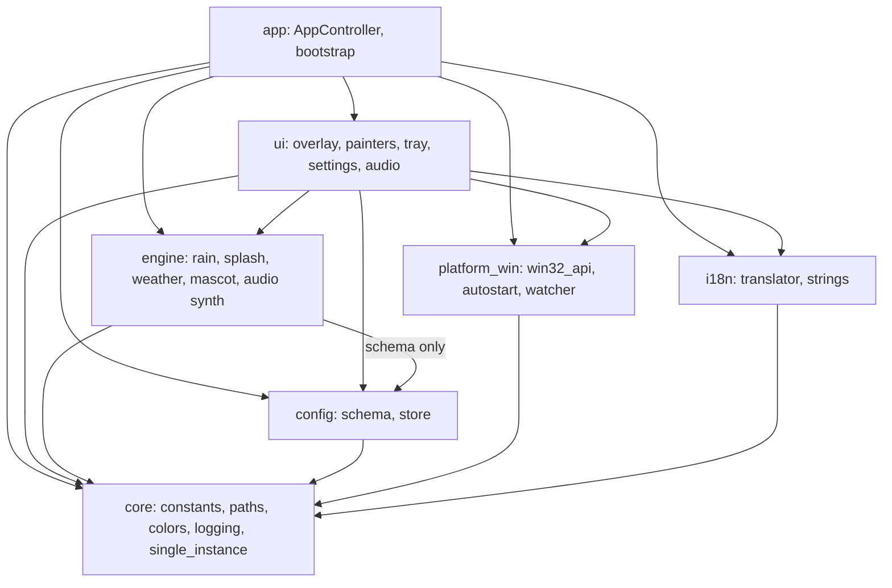
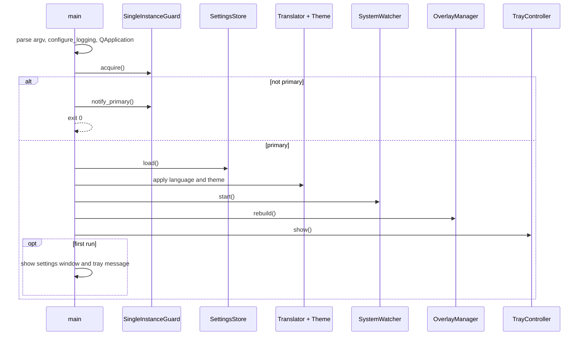
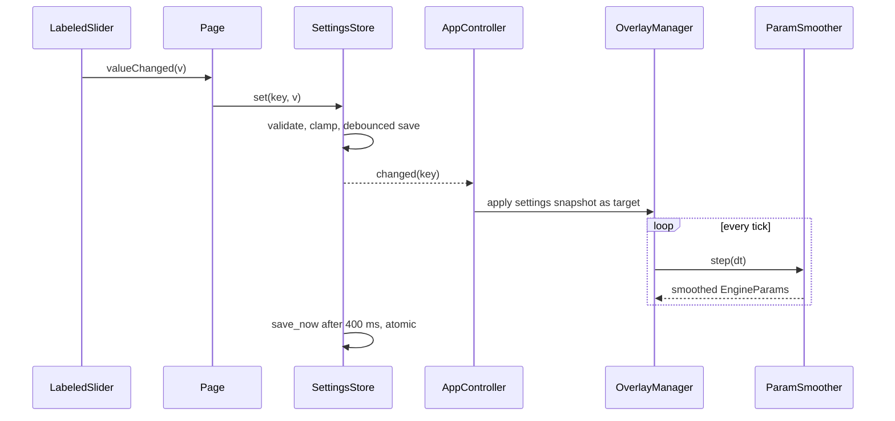
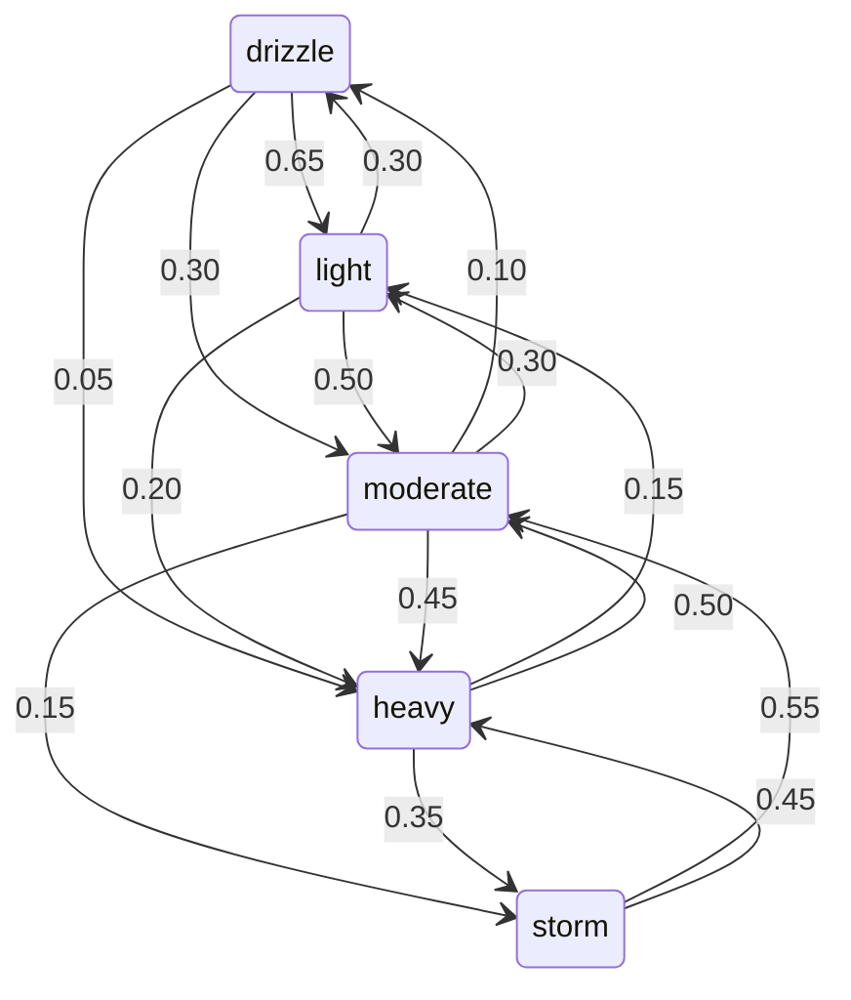
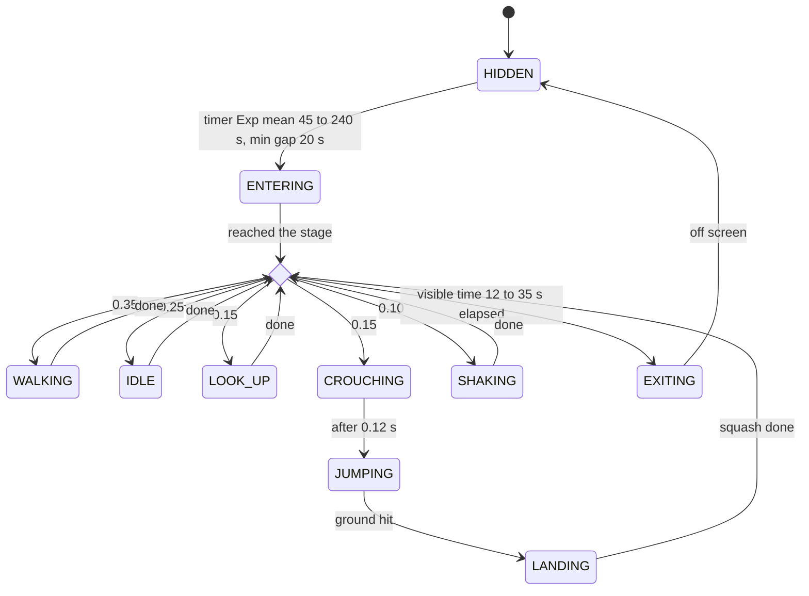
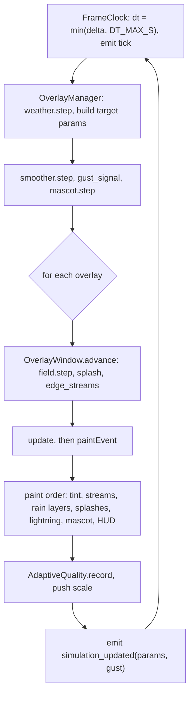
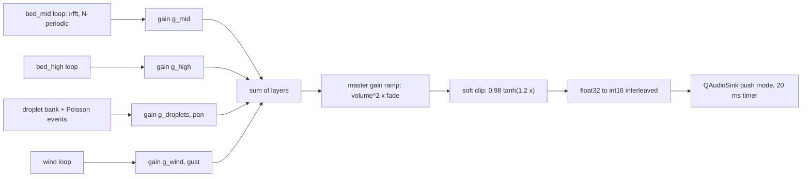

# RainDesk: المعمارية

## 1) شجرة المشروع

```text
RainDesk/
  main.py  pyproject.toml  requirements.txt  requirements-dev.txt
  README.md  THIRD_PARTY_NOTICES.md  .gitignore  raindesk.spec  version_info.txt
  assets/       (raindesk.ico يُولَّد لاحقًا)
  docs/         architecture.md
  tools/        make_icon.py  bench_engine.py  audio_demo.py
  installer/    raindesk.iss
  tests/        conftest.py  test_{math_utils,color_utils,config_schema,settings_store,
                rain_field,splash_system,weather_fsm,adaptive_quality,mascot,rain_audio,
                i18n,theme_contrast,win32_api,autostart}.py
  raindesk/
    __init__.py  __main__.py
    core/          constants  paths  color_utils  logging_setup  single_instance
    config/        schema  store
    engine/        math_utils  params  rain_field  splash_system  edge_streams
                   weather_fsm  mascot  adaptive_quality  rain_audio
    platform_win/  win32_api  autostart  system_watcher
    i18n/          translator  strings_en  strings_ar
    ui/            frame_clock  overlay_window  overlay_manager  tray  theme  settings_window
      painters/    rain_painter  effects_painter  mascot_painter  hud_painter
      widgets/     labeled_slider  toggle_switch  color_button  section_card  screen_picker
      audio/       audio_player
      pages/       base_page  general_page  rain_page  effects_page  mascot_page
                   display_page  advanced_page  about_page
    app/           controller  bootstrap
```

## 2) قواعد الطبقات (فحص التبعيات)

| الطبقة | تستورد من | ملاحظة |
|---|---|---|
| core | لا شيء | `single_instance` يستخدم QtCore وQtNetwork فقط |
| config | core | `schema.py` بلا PySide6، و`store.py` يستخدم QtCore |
| engine | core، و`config.schema` فقط | NumPy والمكتبة القياسية فقط، بلا PySide6 |
| platform_win | core | `win32_api` و`autostart` بلا PySide6، و`system_watcher` يستخدم QtCore |
| i18n | core | |
| ui | config, engine, platform_win, i18n, core | QtMultimedia داخل `ui/audio` فقط وباستيراد كسول |
| app | كل الطبقات | جذر التركيب (Composition Root) |

النتيجة: الترتيب الطوبولوجي `core → {config, platform_win, i18n} → engine → ui → app`. لا توجد دورات، ولا يوجد سهم من طبقة أدنى إلى أعلى. هذا فحص تصميمي لأن الكود لم يُكتب بعد.

## 3) المخططات

### 3.1 مكوّنات الطبقات



### 3.2 تسلسل بدء التطبيق



### 3.3 من تحريك المنزلق إلى التحديث الحي



### 3.4 آلة حالات الطقس (Markov)



### 3.5 آلة حالات الشخصية Drip



### 3.6 حلقة الإطار (كل tick)



### 3.7 خط توليد الصوت



## 4) قرارات التصميم

| # | القرار | البدائل | السبب | النتيجة |
|---|---|---|---|---|
| DD-01 | Python + PySide6 | Electron، C# WPF، Tkinter، pygame | يناسب مهارات الطالب وأقل كلفة أدوات، وQt يوفّر نافذة شفافة وواجهة إعدادات غنية | حزمة أكبر من تطبيق أصلي |
| DD-02 | نافذة overlay لكل شاشة | نافذة عملاقة واحدة | DPI صحيح لكل شاشة وتصفية لكل شاشة | إدارة عدة نوافذ في `OverlayManager` |
| DD-03 | رسم QPainter (raster) | OpenGL | توافق أفضل مع النوافذ الشفافة، والمعالج يكفي لهذا العدد من الجسيمات | لا تسريع GPU |
| DD-04 | NumPy بتخطيط SoA | قائمة كائنات قطرات | تحديث متجه بلا حلقات بايثون وذاكرة متجاورة | كود أقل بداهة |
| DD-05 | تقسيم العمق إلى N طبقات أقلام | قلم مستقل لكل قطرة | تقليل تبديل `QPen` | العمق متقطع وليس متصلًا |
| DD-06 | نموذج التعرّض (طول الخط = السرعة × زمن التعرض) | رسم القطرات نقاطًا | يحاكي تمويه الحركة | يحتاج ثوابت مضبوطة |
| DD-07 | تنعيم أسّي للإعدادات | قفز مباشر، أو tween منفصل | `alpha = 1 - exp(-dt/tau)` يعطي انتقالًا ناعمًا بلا كود إضافي | تأخر طفيف في الاستجابة |
| DD-08 | قواميس بايثون للترجمة | ملفات `.ts/.qm` أو JSON | تجنّب مشاكل تجميع ملفات البيانات | الترجمة تُكتب يدويًا |
| DD-09 | PyInstaller بنمط onedir | onefile | إقلاع أسرع ومسارات موارد أبسط | مجلد كامل بدل ملف واحد |
| DD-10 | نمط Mediator (`AppController` و`OverlayManager`) | ربط إشارات مباشر بين الودجات | فصل الواجهة عن المنطق | كلاس وسيط مركزي |
| DD-11 | `SHQueryUserNotificationState` | تخمين من مستطيل النافذة | واجهة نظام رسمية لحالة ملء الشاشة | يُختبر يدويًا مع تطبيقات مختلفة |
| DD-12 | صوت مولَّد برمجيًا | تسجيلات جاهزة | لا ترخيص ولا حجم إضافي وتحكم لحظي بالشدة والرياح | أقل واقعية من تسجيل حقيقي |
| DD-13 | حلقات ضجيج بطيف مُشكَّل وأطوار عشوائية + irfft | ترشيح IIR لضجيج أبيض | دورية بالبناء دون تلاشٍ متقاطع، ومتجهة بالكامل بلا SciPy | ذاكرة الحلقات نحو 8.5 MB |
| DD-14 | `QAudioSink` بنمط push مع مؤقت 20 ms | نمط pull بصنف `QIODevice` | تحكم أوضح بالتخزين المؤقت والتعافي من underrun | يعتمد على دقة المؤقت |