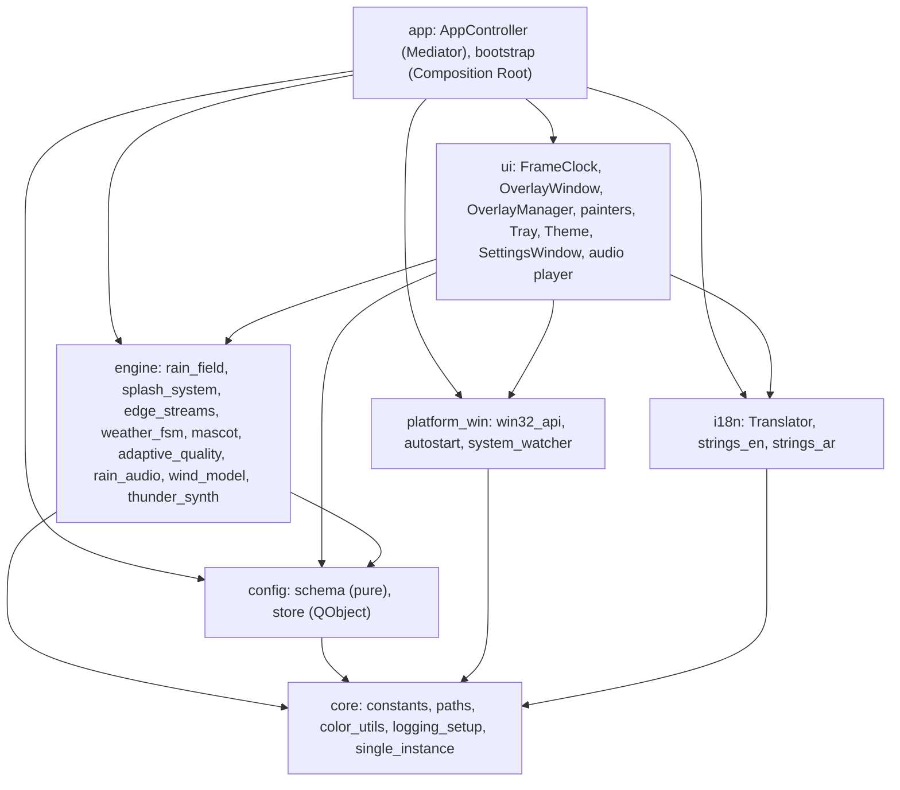
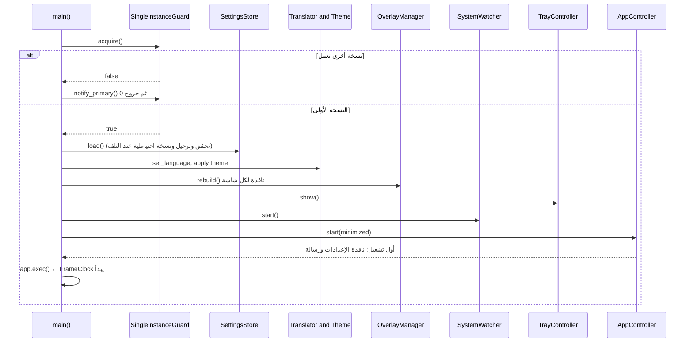
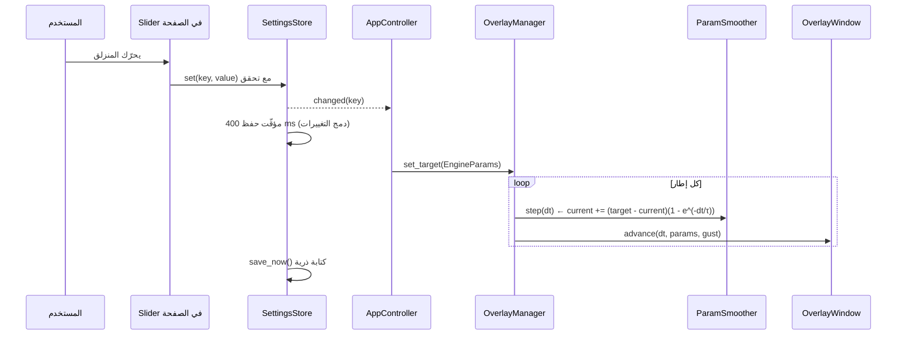
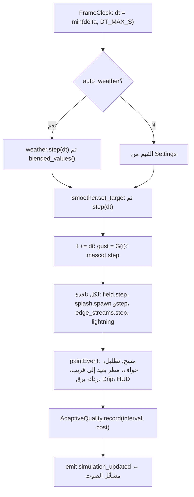
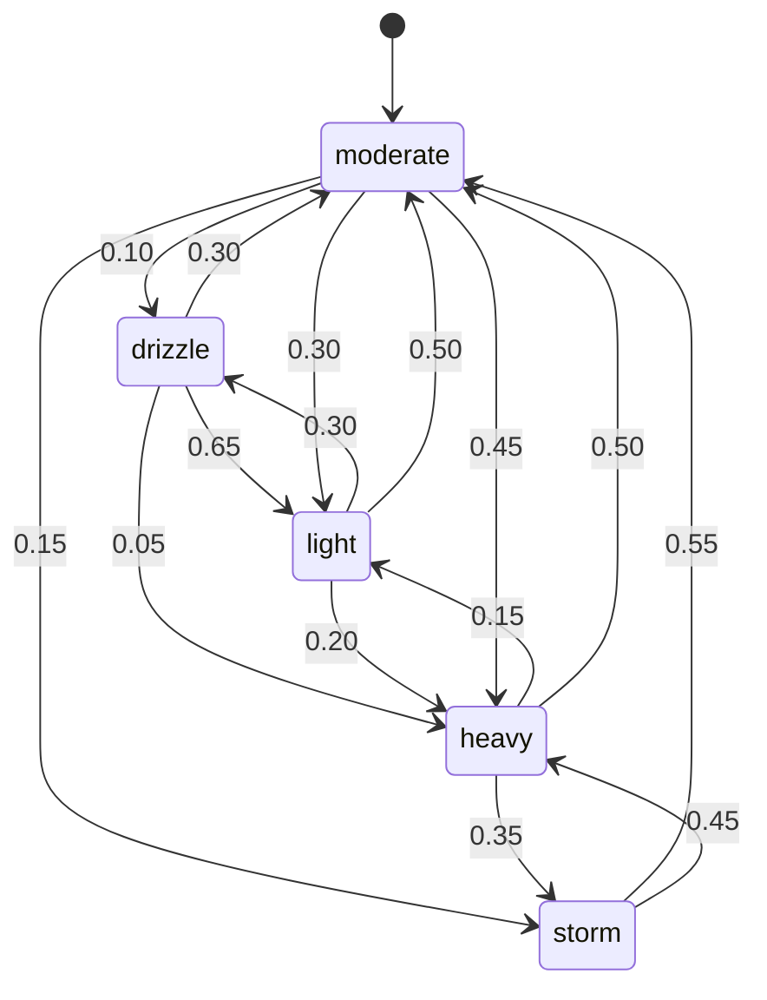
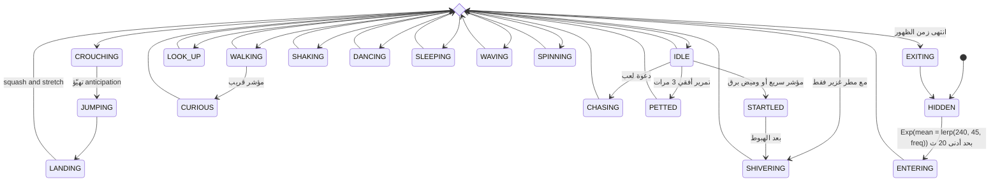
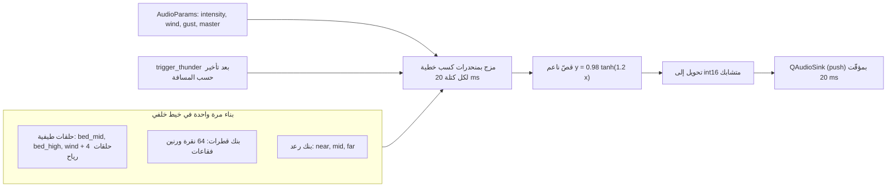

# RainDesk: تصميم وتنفيذ وتقييم تطبيق مطر تفاعلي شفاف لسطح مكتب Windows

**تقرير تقني أكاديمي** · الإصدار 1.1.0 · أكتوبر 2026

> **ملاحظة عن حالة هذه النسخة.** كل ما يخص التصميم والرياضيات والتنفيذ مكتوب من الشيفرة المُسلَّمة فعلًا.
> الأرقام التي تحتاج جهاز Windows الحقيقي (جداول الأداء، ومصفوفة الاختبار اليدوي، وحجم الحزمة) تركتها
> فارغة بعلامة **`[FILL]`** ولم أخمّنها. (الإصدار 1.1.0: مُلئت جداول الأداء 7-1 و7-2 و7-4 وأزمنة الصوت بقياسات
> المؤلف على جهازه، وبقيت فارغة ما لم يُقَس: CPU والذاكرة للعملية، والمصفوفة اليدوية، وحجم الحزمة على Windows.) وكل معلومة لم أتأكد منها من مصدرها موسومة **`[VERIFY]`**.
> انظر الفصل 7 لطريقة جمع الأرقام الناقصة.

---

## الملخص (Abstract)

يعرض هذا التقرير تصميم **RainDesk** وتنفيذه وتقييمه. RainDesk تطبيق خفيف لنظام Windows 10/11 يرسم مطرًا
متحركًا شفافًا فوق سطح المكتب كله على كل الشاشات، دون أن يعترض الفأرة أو لوحة المفاتيح ودون صلاحيات
مدير أو اتصال بالشبكة. بُني بلغة Python 3.12 ومكتبتي PySide6 وNumPy على معمارية طبقية يُفصل فيها المحرك
الرياضي الخالص عن واجهة Qt وعن استدعاءات Win32. يعتمد المحرك على بنية Structure of Arrays ونموذج تعريض
ضوئي (exposure) لطول الخطوط، وعلى تنعيم أسي مستقل عن معدل الإطارات، وعلى آلات حالات للطقس وللشخصية
الكرتونية Drip. يُولَّد الصوت بالكامل برمجيًا: ضجيج دوري مُشكَّل طيفيًا، وقطرات بعملية Poisson ورنين فقاعات
(Minnaert)، ورياح ورعد. يشرح التقرير الاشتقاقات الرياضية (منها band_factor وتركيب التنعيم الأسي ودورية الحلقات الصوتية)، وقرارات التصميم الستة عشر
مع بدائلها ومبرّراتها، وتفاصيل الدمج مع Windows، وتصميم التجربة ومنهجية قياس الأداء بوسيط ومدى ربيعي، ويناقش حدود العمل وتهديدات الصلاحية. اختُبرت المنطقيات الخالصة بمئات الاختبارات الآلية
واختبارات الطفرات، أما قياسات Windows فمنهجيتها جاهزة وأرقامها بانتظار التشغيل على العتاد الفعلي.

**الكلمات المفتاحية:** particle systems، click-through overlay، Qt، procedural audio، stick-slip.

---

## 1. المقدمة (Introduction)

### 1.1 المشكلة والدافع

يحب كثير من المستخدمين أجواء المطر أثناء العمل، لكن الحلول المتاحة على Windows إما خلفيات متحركة تغطيها
النوافذ (فالمطر لا يظهر فوق البرامج المفتوحة)، أو أدوات ثقيلة عامة الغرض، أو تطبيقات تُغلق الإدخال تحتها.
الهدف تطبيق **صغير** يرسم المطر **فوق** كل النوافذ ويترك كل النقرات تمر إلى ما تحتها، ويتوقف تمامًا (CPU ≈ 0)
عند تشغيل لعبة بملء الشاشة أو قفل الجلسة.

استُلهمت الفكرة وظيفيًا من تطبيق Weatherling على macOS [17]، مع تصميم وشيفرة أصليين بالكامل ودون نسخ
أي اسم أو أصل بصري أو برمجي منه.

### 1.2 الأهداف

1. مطر مقنع بصريًا: عمق (parallax) ورياح وعصفات شبه دورية وتحكم بالكثافة والسرعة والطول والسماكة والشفافية واللون.
2. **عدم التطفل**: لا اعتراض للإدخال، ولا سرقة تركيز، ولا خطافات (hooks)، ولا صلاحيات مدير، ولا شبكة.
3. **أداء محدود بميزانية** (الفصل 3.2): مثلًا ≤ 3% من المعالج في الوضع المتوازن عند 30 إطارًا/ث.
4. إعدادات تُطبَّق فورًا وتُحفظ، وواجهة بالعربية (RTL) والإنجليزية (LTR) وثلاث سمات.
5. مؤثرات اختيارية: رذاذ، وجداول ماء على الحواف، وتظليل أجواء، وطقس تلقائي، وبرق ورعد، وشخصية Drip، وصوت مُولَّد.
6. شيفرة مطبوعة الأنواع (`mypy --strict` على الطبقات الخالصة)، موثَّقة، مختبَرة، وقابلة للتغليف.

### 1.3 النطاق (MoSCoW)

| الفئة | المحتوى | الحالة في الإصدار 1.1.0 |
|---|---|---|
| **Must** | نافذة شفافة تمرّر النقرات لكل شاشة؛ محرك جسيمات بعمق ورياح وعصفات؛ أيقونة شريط النظام؛ نافذة إعدادات بتطبيق فوري وإعدادات مسبقة وعشوائي؛ حفظ JSON ذري ومرقَّم الإصدار؛ تشغيل عند الدخول (HKCU Run) وحارس نسخة واحدة؛ إيقاف عند الشاشة الكاملة والقفل؛ i18n وRTL والسمات؛ سجلات وخطّاف أخطاء وإنهاء آمن؛ اختبارات؛ تغليف PyInstaller `onedir` | منجز |
| **Should** | رذاذ؛ جداول الحواف؛ تظليل الأجواء؛ طقس تلقائي (Markov)؛ شخصية Drip؛ استثناء من لقطة الشاشة (تجريبي)؛ إيقاف عند توفير البطارية؛ جودة تكيّفية؛ استيراد/تصدير الإعدادات؛ HUD؛ سكربت قياس؛ شريط عنوان داكن؛ صوت مُولَّد | منجز |
| **Could** | برق (آمن ضوئيًا، مُعطَّل افتراضيًا)؛ مُثبِّت Inno Setup؛ مورد الإصدار؛ مفتاح اختصار عام؛ Drip على شاشة عشوائية؛ رعد متزامن | البرق والرعد والمُثبِّت ومورد الإصدار **أُنجزت**؛ مفتاح الاختصار وDrip على شاشة عشوائية **لم تُنجَز** (الفصل 8) |
| **Won't** | واجهات طقس حقيقي؛ ملفات صوت مسجّلة؛ منصات أخرى؛ تتبّع (telemetry)؛ أدوات مدفوعة أو شهادات توقيع | خارج النطاق |

---

## 2. الخلفية والأعمال ذات الصلة

### 2.1 أنظمة الجسيمات (Particle Systems)

قدّم Reeves [1] أنظمة الجسيمات لنمذجة «الأجسام الضبابية» (النار والدخان والمطر) كمجموعة كبيرة من الجسيمات
الصغيرة، لكل منها عمر وموضع وسرعة ولون، تُولَّد وتُحدَّث وتُرسَم ثم تُزال. RainDesk تتبع هذا النمط:
تُولَّد القطرات فوق الشاشة، وتتحرك بسرعة حدّية ثابتة، وتُدوَّر (recycle) عند الخروج أو الهبوط. الفرق
الهندسي أن الجسيمات هنا تُخزَّن كمصفوفات NumPy متجاورة (Structure of Arrays) وتُحدَّث دفعة واحدة، لا ككائنات
منفصلة (القرار DD-04).

ولتحريك الجداول والعصف استُعملت فكرة الضجيج المتماسك (coherent noise) التي طرحها Perlin [3]. استُبدل
بالضجيج الحقيقي مجموع جيوب بدرجات غير متناسبة يقاربه بتكلفة O(1) (الفصل 5.4).

### 2.2 النوافذ الطبقية (Layered Windows) وتركيب DWM

تعرض Windows كل نافذة عبر **Desktop Window Manager (DWM)** الذي يركّب مخازن النوافذ على الشاشة. لجعل نافذة
شفافة بالبكسل تُستعمل النافذة الطبقية (`WS_EX_LAYERED`)، فتُحسب شفافية كل بكسل (per-pixel alpha). ولتمرير
النقرات للنافذة التي تحتها يُضاف النمط `WS_EX_TRANSPARENT`. في Qt يؤدي العَلَم `Qt.WindowTransparentForInput`
هذا الدور، وتوفّر `WA_TranslucentBackground` النافذة الطبقية [12][13]. ويُضاف `Qt.Tool` (لا زر في شريط
المهام) و`WindowDoesNotAcceptFocus` (`WS_EX_NOACTIVATE`: لا تصير النافذة أبدًا في المقدمة). ولا يكفي
`WA_TransparentForMouseEvents` وحده لأنه يغيّر توزيع الأحداث داخل Qt فقط لا على مستوى النظام.

### 2.3 أدوات مشابهة

| الأداة | المنصة والترخيص | الفكرة | الفرق عن RainDesk |
|---|---|---|---|
| **Weatherling** [17] | macOS 14+؛ تجاري ($1.99 مرة واحدة في Mac App Store) | تطبيق شريط قوائم يضيف مطرًا وثلجًا وأوراق خريف بين النوافذ؛ يمرّر النقرات؛ يتوقف افتراضيًا عند الشاشة الكاملة؛ صوت اختياري؛ كائنات «Lings» صغيرة يمكن التفاعل معها | macOS فقط وشيفرته مغلقة. هو **الإلهام الوظيفي** وRainDesk تصميم أصلي لـ Windows |
| **Rainmeter** [15] | Windows 7 SP1+؛ مفتوح المصدر GPLv2؛ منذ 2001 | أداة تخصيص لسطح المكتب تعرض «جلود» (skins) وأدوات؛ تُبرمج بملفات إعداد | عامة الغرض وليست مخصصة للمطر؛ بناء مطر مقنع بها يحتاج كتابة جلد وتقنيات خاصة |
| **Wallpaper Engine** [16] | Windows 10/11 (Steam)؛ تجاري ($4.99) | خلفيات سطح مكتب متحركة (فيديو، 2D/3D، ويب) مع ورشة مجتمعية | تتحرك **الخلفية** فقط، فتغطيها النوافذ المفتوحة، ولا يظهر المطر فوق البرامج؛ حجمها وكلفتها أكبر |
| **RainDesk** | Windows 10/11؛ مشروع أكاديمي | طبقة مطر **فوق** كل النوافذ وكل الشاشات، بلا صلاحيات ولا شبكة، مع صوت مُولَّد وشخصية | — |

*أسعار الأدوات التجارية وإصداراتها مأخوذة من صفحاتها الرسمية بتاريخ 2026-10-11 وقد تتغير.*

### 2.4 الفجوة التي يملؤها العمل

لا تجمع الأدوات السابقة بين: (أ) مطر **فوق** النوافذ على Windows، و(ب) عدم الحاجة إلى صلاحيات أو خطافات أو
لقطة شاشة، و(ج) صوت مُولَّد بالكامل بلا ملفات، و(د) استهلاك قابل للقياس والإثبات. هذه الفجوة هي موضوع المشروع.

---

## 3. المتطلبات (Requirements)

### 3.1 المتطلبات الوظيفية

| الرمز | المتطلب | الأولوية |
|---|---|---|
| FR-01 | تُرسم نافذة شفافة بلا إطار فوق كل شاشة مختارة ولا تعترض الإدخال ولا تأخذ التركيز | Must |
| FR-02 | تُظهر القطرات عمقًا (حجم وسرعة وشفافية حسب البعد) وميلًا بحسب الرياح وعصفات شبه دورية | Must |
| FR-03 | تتحكم الإعدادات بالكثافة والسرعة والطول والسماكة والشفافية واللون والرياح | Must |
| FR-04 | يتغير أي إعداد **فورًا** بلا زر «تطبيق» ويُحفظ بين الجلسات | Must |
| FR-05 | أيقونة شريط النظام: تشغيل/إيقاف، إعدادات، عشوائي، خروج | Must |
| FR-06 | يتوقف الرسم عند تطبيق بملء الشاشة أو قفل الجلسة أو توفير البطارية | Must/Should |
| FR-07 | حارس نسخة واحدة: النسخة الثانية تُظهر إعدادات الأولى ثم تخرج | Must |
| FR-08 | تشغيل عند الدخول عبر `HKCU\...\Run` مع `--minimized` | Must |
| FR-09 | واجهة بالعربية (RTL) والإنجليزية (LTR) وسمات فاتح/داكن/نظام | Must |
| FR-10 | رذاذ عند الهبوط وجداول ماء على الحواف وتظليل أجواء | Should |
| FR-11 | طقس تلقائي بآلة حالات Markov وانتقالات ناعمة | Should |
| FR-12 | شخصية Drip تظهر عشوائيًا وتتفاعل مع المؤشر ويمكن تعطيلها | Should |
| FR-13 | صوت مطر مُولَّد برمجيًا، مُعطَّل افتراضيًا، يتبع الشدة والرياح، مع مستوى للرياح ومستوى للرعد | Should |
| FR-14 | جودة تكيّفية تخفض العدد عند الضغط وتستعيده بتباطؤ (hysteresis) | Should |
| FR-15 | استيراد/تصدير الإعدادات؛ HUD للتشخيص؛ استثناء من اللقطة (تجريبي) | Should |
| FR-16 | برق آمن ضوئيًا (WCAG 2.3.1) مُعطَّل افتراضيًا مع رعد متأخر مناسب | Could |

### 3.2 المتطلبات غير الوظيفية (ميزانية الأداء)

الجهاز المرجعي: حاسوب محمول متوسط، 4 أنوية، رسوميات مدمجة، 1920×1080 بتكبير 125%، Windows 11.

| المقياس | الهدف |
|---|---|
| CPU في الحالة المستقرة | ≤ 3% (متوازن، 30 إطارًا/ث، شدة 0.5)؛ ≤ 8% (شدة 1.0، 60 إطارًا/ث) |
| الذاكرة (working set) | ≤ 150 MB من المصدر؛ ≤ 180 MB للحزمة |
| البدء حتى أول إطار | ≤ 2.5 ث (بناء `onedir`) |
| خطوة المحرك | ≤ 1.0 ms عند 1000 قطرة؛ ≤ 3.0 ms عند 5000 |
| زمن الرسم عند 1080p | ≤ 6 ms عند 1000 قطرة (متوازن) |
| حالة الإيقاف | ≈ 0% CPU (المؤقتات متوقفة ولا إعادة رسم) |
| إضافة الصوت | ≤ 1% CPU؛ توليد كتلة 20 ms ≤ 0.5 ms عند شدة 1.0 |
| تسرّب الذاكرة | نمو RSS < 5% خلال 60 دقيقة |

متطلبات أخرى: لا صلاحيات مدير، ولا شبكة، ولا خطافات عامة، وكل كتابة تسجيل تقتصر على قيمة `Run` الواحدة.

### 3.3 حالات الاستخدام (Use Cases)

| الرمز | الحالة | السيناريو الرئيسي |
|---|---|---|
| UC-01 | تشغيل المطر أول مرة | يفتح المستخدم البرنامج ← تظهر نافذة الإعدادات ورسالة في الشريط ← يرى المطر فورًا ← يغلق النافذة ويبقى التطبيق في الشريط |
| UC-02 | ضبط الشدة | يحرّك منزلق الشدة ← يتغير المطر بسلاسة خلال ~0.75 ث دون قفزة ← يُحفظ الإعداد بعد 400 ms |
| UC-03 | لعب بملء الشاشة | تبدأ لعبة بملء الشاشة ← يكتشف المراقب الحالة ← تُخفى النوافذ وتتوقف الساعة والصوت ← عند الخروج يستأنف |
| UC-04 | تفاعل مع Drip | يمرّ المؤشر قرب Drip ← يلتفت أو يهرب أو يلاحق ← تحريك المؤشر أفقيًا فوقه يداعبه |
| UC-05 | تشغيل الصوت | يفعّل الصوت ← يُبنى المولّد في خيط خلفي ← يتصاعد الصوت تدريجيًا (fade-in) ← الرعد يتبع كل وميض بتأخير |
| UC-06 | تغيير اللغة | يختار العربية ← تُترجم كل الواجهة وينقلب الاتجاه فورًا دون إعادة تشغيل |

### 3.4 معايير القبول

| المعيار | طريقة التحقق |
|---|---|
| النقر يصل إلى النافذة التي تحت المطر | اختبار يدوي (المصفوفة، الفصل 7.5) |
| لا يظهر زر في شريط المهام ولا في Alt+Tab | يدوي |
| تغيّر الإعداد ينعكس فورًا في الواجهة وفي الرسم وبعد إعادة التشغيل | اختبارات `SettingsStore` + يدوي |
| `Σ` كل صف في مصفوفة الطقس = 1 (±1e-9) | اختبار آلي |
| التنعيم يُركَّب بدقة (n خطوة بـ dt/n = خطوة dt) إلى 1e-9 | اختبار آلي |
| سقف شدة البرق ≤ 0.30 مهما كانت القيمة الواردة | اختبار آلي |
| مجموع قطرات الشاشة ≤ السعة 5000 دائمًا | اختبار آلي |
| القيمة المطلقة للصوت لا تتجاوز 0.98 ولا يحدث نقر عند التشغيل والإيقاف | اختبارات رقمية |

---

## 4. المعمارية (Architecture)

### 4.1 الطبقات

المعمارية **طبقية موجّهة بالأحداث** (إشارات Qt). يُفصل فيها المنطق الخالص (المحرك والمخطط) عن محوّلات Qt (`ui`)
وعن محوّلات النظام (`platform_win`). الاعتماد في اتجاه واحد فقط: `ui ← app ← engine/config/platform_win/i18n ← core`،
ويُمنع على `engine/` أي استيراد لـ PySide6، فيمكن اختباره بلا واجهة.



**ملكية الحالة.** الحالة المحفوظة (`Settings`) مصدر واحد للحقيقة داخل `SettingsStore`. والحالة الحية المشتقة
(`EngineParams`) تتحرك بتنعيم نحو الهدف. ولا تحتفظ الأدوات (widgets) بحالة أعمال. أما الرياح والطقس والتنعيم وDrip
فمشتركة بين الشاشات ويملكها `OverlayManager`، بينما تملك كل نافذة `RainField` و`SplashSystem` و`EdgeStreams` لشاشتها وحدها.

### 4.2 الأنماط التصميمية

| النمط | أين | الفائدة |
|---|---|---|
| Composition Root | `bootstrap.main` | كل الربط والبناء في مكان واحد |
| Mediator | `AppController`، `OverlayManager` | لا ربط مباشر بين الأدوات؛ تتغير الواجهة دون المساس بالمحرك |
| Observer | إشارات Qt (`changed`, `tick`, `reasons_changed`) | فصل المُصدِر عن المستهلك |
| Structure of Arrays | `RainField`, `SplashSystem`, `EdgeStreams` | حساب متجه وذاكرة متجاورة |
| Ring Buffer | رذاذ، أثر القطرات، الحبيبات، ذيل الصوت | سعة ثابتة بلا تخصيص لكل إطار |
| State Machine | `WeatherStateMachine`, `Mascot`, حالة القطرة (ملتصقة/منزلقة) | سلوك متوقَّع قابل للاختبار |
| Batching/Quantization | `paint_*` بدلاء الشفافية والعمق | أقل تبديل لأقلام الرسم |
| Strategy (بيانات) | `PRESETS`, `QUALITY_PROFILES`, `KIND_TABLE` | سلوك قابل للتبديل بجداول |
| Facade | `RainSynth` | واجهة بسيطة فوق حلقات وقطرات ورياح ورعد |

### 4.3 تسلسل بدء التشغيل



### 4.4 تسلسل تغيير منزلق حتى التحديث الحي



### 4.5 حلقة الإطار (Per-tick)



### 4.6 آلة حالات الطقس



### 4.7 آلة حالات Drip

الحالات الأساسية في المواصفة عشر. توسّعت في التنفيذ إلى **19 حالة** لإضافة الشخصية والتفاعل مع المؤشر
(طلب المستخدم: «أكثر لطافة وتفاعلًا»). المنطق في `engine/mascot*.py` بلا Qt، والرسم في `ui/painters/mascot_*.py`.



أولوية ردود الفعل: **مداعبة ← فزع ← مطاردة ← فضول**، وتبدأ فقط من الحالات الهادئة. يُقرأ المؤشر بـ
`QCursor.pos()` ولا يُعترَض أبدًا، فلا يتعارض ذلك مع شرط عدم التطفل.

### 4.8 خط أنابيب توليد الصوت



### 4.9 قرارات التصميم (Design Decisions)

لكل قرار: البدائل، والاختيار، والمبرّر.

| الرمز | القرار | البدائل | الاختيار والمبرّر |
|---|---|---|---|
| **DD-01** | لغة وإطار | C++/Win32؛ C#/WPF؛ Electron؛ Python+PySide6 | **Python 3.12 + PySide6**: سرعة التطوير ونافذة شفافة جاهزة وNumPy للحساب المتجه، وكلفة الأداء مقبولة لأن الرسم مجمَّع دفعات. الثمن حجم الحزمة |
| **DD-02** | نافذة لكل شاشة أم نافذة عملاقة | نافذة واحدة بحجم سطح المكتب الافتراضي | **نافذة لكل شاشة**: DPI صحيح لكل شاشة، وترشيح لكل شاشة، وتجنّب مخازن ضخمة عند اختلاف الأحجام |
| **DD-03** | الرسم | OpenGL (`QOpenGLWidget`)؛ QPainter | **QPainter raster**: `QOpenGLWidget` فيه مخاطر توافق مع النوافذ الطبقية الشفافة؛ وQPainter كافٍ عند التجميع |
| **DD-04** | تخزين الجسيمات | قائمة كائنات Python؛ مصفوفات | **NumPy SoA float32**: `step()` بتعقيد O(N) متجه، وذاكرة O(السعة)، ولا تخصيص لكل إطار |
| **DD-05** | تجميع الرسم | قلم لكل قطرة؛ دلاء عمق | **دلاء عمق L**: قلم واحد وأمر `drawLines` واحد لكل دلو؛ يضحّى بتكميم صغير للعمق مقابل تبديلات أقل بكثير |
| **DD-06** | شكل الخط | طول ثابت؛ نموذج تعريض | **نموذج التعريض**: الطول = السرعة × زمن التعريض × معامل الطول، فتترك الأسرع خطوطًا أطول تلقائيًا (الفصل 5.2) |
| **DD-07** | تغيير الإعدادات | قفز مباشر؛ تنعيم | **تنعيم أسي** مستقل عن معدل الإطارات ويتركّب بدقة (الفصل 5.3) |
| **DD-08** | الترجمة | `.ts/.qm`؛ JSON؛ وحدات Python | **وحدات Python (dict)**: لا ملفات بيانات تُنسى عند التغليف، وتحقق آلي من تطابق المفاتيح بين اللغتين |
| **DD-09** | التغليف | `onefile`؛ `onedir` | **`onedir`**: `onefile` يفك مئات الميغابايت في `%TEMP%` عند كل تشغيل (بدء بطيء وإنذارات مضادات فيروسات أكثر) |
| **DD-10** | الربط | ربط إشارات مباشر بين الأدوات؛ وسيط | **Mediator** (`AppController`, `OverlayManager`): نقطة واحدة تفهم التدفق، وتبقى الأدوات بلا معرفة ببعضها |
| **DD-11** | اكتشاف الشاشة الكاملة | هيوريستيك مستطيل النافذة؛ `SHQueryUserNotificationState` | **الواجهة الرسمية**: تغطي القفل والعرض التقديمي وD3D كامل الشاشة بلا تخمين [13] |
| **DD-12** | مصدر الصوت | عينات مسجلة؛ توليف برمجي | **توليف**: لا ترخيص ولا حجم، وتحكم لحظي كامل بالشدة والرياح والرعد |
| **DD-13** | حلقات الضجيج | ترشيح IIR لضجيج أبيض؛ تشكيل طيفي + `irfft` | **تشكيل طيفي بأطوار عشوائية**: دورية بالبناء (فلا تقطيع عند التكرار) ومتجهة بالكامل وبلا SciPy (الفصل 5.5) |
| **DD-14** | تغذية الصوت | وضع سحب (QIODevice)؛ وضع دفع | **دفع بمؤقّت 20 ms** (`PreciseTimer`): أبسط وأسهل في المحاكاة بالاختبار |
| **DD-15** *(أُضيف أثناء التنفيذ)* | جداول الحواف | مسارات جيبية متمايلة (المواصفة الأولى)؛ نموذج قطرات | **نموذج قطرات stick-slip**: رُفض الجيبي بعد التجربة لأنه يشبه أسلاكًا متقاطعة لا ماءً (الفصل 5.7) |
| **DD-16** *(أُضيف أثناء التنفيذ)* | بناء مولّد الصوت وحالة المشغّل | بناء في خيط الواجهة؛ بناء في خيط خلفي. ربط `stateChanged`؛ استقصاء | **خيط خلفي**: البناء على الخيط الرئيسي يعطّل الواجهة طوال مدته (بعد النقل صارت أطول فجوة في الخيط الرئيسي 4 ms لأن NumPy يحرّر GIL أثناء الحساب). و**استقصاء الحالة والخطأ** لأن PySide6 رمى `TypeError` عند ربط `stateChanged` بنوع `QAudio::State` |

> **ملاحظة صدق.** DD-16 يخالف نصّ المواصفة («البناء على خيط الواجهة»). المبرّر قياسي: المواصفة نفسها تشترط
> ألا يتجاوز البناء 400 ms وإلا يُخفَّض الطول، وفي التنفيذ فُضِّل نقله إلى خيط خلفي لتبقى الواجهة سلسة.

---

## 5. التصميم التفصيلي (Detailed Design)

نظام الإحداثيات: بكسلات منطقية (مستقلة عن الجهاز)، الأصل أعلى يسار كل شاشة، +x يمينًا و+y للأسفل. يعمل المحرك
بالبكسلات المنطقية وتطبّق Qt نسبة `devicePixelRatio` عند الرسم.

### 5.1 الزمن والتكامل العددي

$$dt = \min(\Delta t_{\text{measured}},\ \text{DT\_MAX\_S}),\qquad \text{DT\_MAX\_S}=0.05\ \text{s}$$

- **قطرات المطر:** سرعة حدّية ثابتة، فالتكامل $x \mathrel{+}= v_x\,dt$ و$y \mathrel{+}= v_y\,dt$ **دقيق** بأي $dt$ (لا تسارع).
- **الرذاذ:** أويلر شبه ضمني (symplectic): $v \mathrel{+}= a\,dt$ ثم $x \mathrel{+}= v\,dt$، وهو مستقر طاقيًا للخطوات الصغيرة.
- **قفزة Drip والقطرة المنزلقة:** قفزة Drip تُحسب تحليليًا $y=y_0+v_0t+\tfrac12 g t^2$ فلا يتراكم خطأ؛ وسرعة القطرة المنزلقة تتبع حلًّا أسيًا بخطوة صغيرة.

**لماذا يكفي $dt$ متغير مقيَّد؟** يوصي Fiedler [6] بخطوة ثابتة مع مجمِّع (accumulator) حين تكون الديناميكا
**متصلّبة (stiff)** أو حين يلزم **تحديد (determinism) عبر الأجهزة**. هنا لا هذا ولا ذاك: لا نوابض ولا تصادمات
حرجة، ولا يطلب أحد تطابق لقطة المطر بين جهازين (وللاختبار بذرة `rng_seed`). وغاية القيد $dt\le 0.05$ ألا تقفز
المحاكاة بعد نوم الجهاز أو سحب نافذة أو توقف مصحّح: عند أقل من 20 إطارًا/ث تتباطأ المحاكاة بدل أن تقفز.

### 5.2 حقل المطر (RainField)

**التخطيط.** مصفوفات `float32` (x, y, z, jitter) مع مخازن مؤقتة مسبقة التخصيص؛ السعة 5000 قطرة لكل شاشة.
الاعتماد على `z` (0 بعيد … 1 قريب) يعطي العمق.

**الكثافة المستهدفة.**

$$\text{density}(i)=D_{\min}+(D_{\max}-D_{\min})\,i^{1.5},\qquad D_{\min}=30,\ D_{\max}=600\ \ \text{قطرة/MP}$$

$$n=\min\Big(\text{capacity},\ \operatorname{round}\big(\text{multiplier}\cdot A_{\text{MP}}\cdot \text{density}(i)\cdot \beta\big)\Big)$$

حيث $A_{\text{MP}}=WH/10^6$ بالبكسل المنطقي، فالكثافة مستقلة عن الدقة، و$\beta$ هو band_factor.

**اشتقاق band_factor.** تُولَّد القطرات في **شريط أعرض من الشاشة** حتى تدخل القطرات المائلة من الجانبين. عرض
الشريط عند ميل $\theta$ (زاوية الرياح الأساسية المنعَّمة، لا اللحظية):

$$B=W+(H+m)\,|\tan\theta|+2\,\text{pad},\qquad m=0.25H,\ \ \text{pad}=40\ \text{px}$$

يعبر القطرة طول الشاشة بإزاحة أفقية $(H+m)|\tan\theta|$ على الأكثر، فيلزم هذا الامتداد. لا يرى المشاهد من
القطرات إلا نسبة $W/B$ (الباقي خارج الشاشة). فلاستعادة الكثافة المرئية المقصودة يُضرب حجم المجموعة بمقلوب هذه
النسبة:

$$\beta=\frac{B}{W}=\frac{W+(H+m)|\tan\theta|+2\,\text{pad}}{W}$$

*مثال عددي* (1920×1080، $m=270$): عند $\theta=12^\circ$ تكون $\beta=1.191$؛ وعند $28^\circ$ (عاصفة)
$\beta=1.416$. وعند الشدة 0.5: الكثافة 231.5 قطرة/MP ومساحة 2.0736 MP، أي 480 قطرة قبل المعامل و**572** بعده.
وعند الشدة 1.0: 1244 قطرة قبل المعامل و1482 بعده (تحت سقف 5000).

**كثافة x منتظمة (إثبات مختصر).** تُولَّد القطرة عند $y_0=-U(0,m)$ و$x_0$ منتظم في
$[a,b]$ مع $a=-(H+m)\max(t,0)-\text{pad}$ و$b=W-(H+m)\min(t,0)+\text{pad}$ حيث $t=\tan\theta$. بعد النزول إلى
الارتفاع $y$ تصير $x=x_0+(y-y_0)t$، أي **إزاحة** لـ $x_0$ بمقدار يعتمد على $y$ وعلى $y_0$ فقط. والمنطقة
المرئية $[0,W]$ تقابل $x_0\in[-(y-y_0)t,\ W-(y-y_0)t]$، وهذه تقع كلها داخل $[a,b]$ لأن
$0\le y-y_0\le H+m$. إذن كل نقطة مرئية يصلها تدفّق منتظم، فالكثافة منتظمة عند كل ارتفاع.

**التوزيع في العمق.** $z=u^{1.6}$ حيث $u\sim U(0,1)$، فيميل إلى البعيد: كثير من القطرات الصغيرة وأقل من الكبيرة.

**التوهين بالعمق** (مع $p$ = parallax_strength):

$$f_{\text{speed}}(z)=\operatorname{lerp}(1-0.55p,\ 1,\ z),\quad f_{\text{thick}}(z)=\operatorname{lerp}(1-0.60p,\ 1,\ z),\quad f_{\alpha}(z)=\operatorname{lerp}(1-0.70p,\ 1,\ z)$$

**السرعة.** $v_y=1400\cdot\text{speed}\cdot f_{\text{speed}}(z)\cdot j$ مع $j\in[0.94,1.06]$ ثابت لكل قطرة، و

$$\theta_{\text{eff}}=\operatorname{clamp}\big(\theta+\text{gusts}\cdot 25^\circ\cdot G(t),\ -75^\circ,\ 75^\circ\big),\qquad v_x=v_y\tan\theta_{\text{eff}}$$

القصّ عند ±75° يمنع انفجار $\tan$ قرب 90°.

**نموذج التعريض (DD-06).** مثل كاميرا بزمن مصراع $T_{\exp}$ تترك القطرة السريعة أثرًا أطول:

$$\ell = |v|\cdot T_{\exp}\cdot \text{drop\_length},\qquad T_{\exp}=0.030\ \text{s}$$

للقطرة القريبة ($z=1$، سرعة 1) $\ell=1400\times0.030=42$ بكسل، وللأبعد ($z=0$، $p=0.7$) $f_{\text{speed}}=0.615$
فيكون $\ell\approx25.8$ بكسل. فالقطرات البعيدة أقصر وأبطأ تلقائيًا دون معامل إضافي.

**الهبوط وإعادة التدوير.** ترى الشاشة هبوطًا حين $y_{\text{head}}\ge y_{\text{ground}}$ (حيث $y_{\text{ground}}=H$ أو
$\operatorname{lerp}(0.6H,H,z)$ في `depth_plane`) ثم تُدوَّر القطرة ويُسجَّل الهبوط للرذاذ. وتُدوَّر أيضًا حين يتجاوز
ذيلها $H+40$ أو تخرج $x$ من الشريط.

**التعقيد.** `step()` بتعقيد $O(N)$ ومتجه بالكامل، والذاكرة $O(\text{capacity})$.

### 5.3 التنعيم الأسي للمعاملات (DD-07)

$$c_{k+1}=c_k+(\tau_{\text{target}}-c_k)\big(1-e^{-dt/\tau}\big),\qquad \tau=0.25\ \text{s}$$

**الخاصية الأساسية: التركيب الدقيق.** الخطأ $e=\text{target}-c$ يُضرب في $e^{-dt/\tau}$ كل خطوة، فبعد $n$ خطوات بـ $dt/n$:

$$e_n=e_0\Big(e^{-dt/(n\tau)}\Big)^n=e_0\,e^{-dt/\tau}$$

أي **n خطوة بـ dt/n تساوي خطوة dt تمامًا**، فالانزلاق مستقل عن معدل الإطارات (اختبار آلي بدقة 1e-9). والخطوة
مستقرة لأي $dt$ لأن المعامل $1-e^{-dt/\tau}\in(0,1)$ دائمًا. زمن الوصول إلى 95% هو
$\tau\ln 20\approx0.75$ ثانية. تُنعَّم الحقول العشرية فقط، ويطبَّق `depth_layers` واللون فورًا.

### 5.4 دالة العصف

$$G(t)=0.6\sin\!\Big(\frac{2\pi t}{T}+f_1\Big)+0.3\sin\!\Big(\frac{2\pi t}{0.37T}+f_2\Big)+0.1\sin\!\Big(\frac{2\pi t}{2.3T}+f_3\Big)$$

مجموع السعات 1 فـ $G\in[-1,1]$. الأطوار $f_1,f_2,f_3$ عشوائية ثابتة للجلسة. هذه الدالة **تقريب بكلفة O(1)** للضجيج
المتماسك أحادي البعد لدى Perlin [3]: مجموع «أوكتافات» بترددات غير متناسبة وسعات متناقصة. والدورة الدقيقة هي
المضاعف المشترك الأصغر للدورات $T$ و$0.37T$ و$2.3T$، وهو $\operatorname{lcm}(1,37,23)\,T=851T$؛ أي
**5957 ثانية (نحو 99 دقيقة)** عند $T=7$ ثوانٍ، فلا تكرار يلاحظه المشاهد عمليًا.

### 5.5 نموذج الصوت

#### (أ) حلقات ضجيج دورية بالتشكيل الطيفي (DD-13)

نبني حلقة من $N=\operatorname{round}(8\cdot f_s)=352800$ عينة عند $f_s=44100$ هرتز. نختار لكل حزمة rFFT
$k$ مقدارًا $M(f_k)$ وطورًا عشوائيًا $\varphi_k$، ثم:

$$X[k]=M(f_k)\,e^{i\varphi_k},\qquad x[n]=\operatorname{irfft}(X)[n]=\frac1N\sum_k X[k]\,e^{2\pi i kn/N}$$

كل أساس $e^{2\pi i kn/N}$ دوري بدورة $N$ بالضبط، فالإشارة كلها **دورية بدورة $N$**: التكرار سلس بلا تلاشٍ متقاطع
(cross-fade). نستعمل أطوارًا مستقلة لكل قناة لتخالف اليسار اليمين (عرض ستيريو). بعد التوليد نزيل DC ونضبط RMS إلى 0.2.

| الحلقة | شكل المقدار $\lvert X\rvert$ | القدرة (PSD) | الدور |
|---|---|---|---|
| `bed_mid` | $f^{-0.5}$ بين 300 و9000 Hz | $\propto f^{-1}$ أي −3 dB/أوكتاف (وردي، Voss–Clarke [11]) | جسم المطر |
| `bed_high` | مسطّح 4–12 kHz | أبيض | حفيف يزداد مع الشدة |
| `wind` | $f^{-1}$ بين 40 و500 Hz | $\propto f^{-2}$ أي −6 dB/أوكتاف | جسم الرياح الأدنى |

حواف كل نطاق «منحدرات» (skirts) من جيب التمام المرفوع بعرض ثلث أوكتاف، تمنع حدودًا حادة تسمع كرنين.

#### (ب) قطرات بعملية Poisson ورنين فقاعات Minnaert

يصل عدد القطرات في كتلة زمنها $\Delta$ من توزيع $\text{Poisson}(\lambda\Delta)$ حيث

$$\lambda=220\cdot i^{1.2}\ \ \text{حدث/ث},\qquad i=\operatorname{clamp}(\text{intensity},0,1)$$

وبسبب استقلال العدّ على مجالات منفصلة (خاصية عملية Poisson) يكفي سحب عدد مستقل لكل كتلة. لكل حدث: رقم عشوائي من
بنك 64 نقرة، وإزاحة بداية داخل الكتلة، وكسب $U(0.15,1)^2$، وتوزيع ستيريو بقانون القدرة المتساوية
$g_L=\cos(p\pi/2)$ و$g_R=\sin(p\pi/2)$ (فـ $g_L^2+g_R^2=1$: القدرة ثابتة مهما كان الموضع).

نقرة البنك: انفجار ضجيج مُمرَّر للأعلى (20–60 ms) بتضاؤل أسي $\tau\in[3,10]$ ms، و**60%** منها تحمل رنين فقاعة. تهتز
فقاعة هواء نصف قطرها $r$ في الماء بتردد Minnaert [9]:

$$f_0=\frac{1}{2\pi r}\sqrt{\frac{3\gamma p_0}{\rho}}\ \approx\ \frac{3.26}{r}\ \text{Hz}\ (r\ \text{بالمتر})$$

(الحساب بـ $\gamma=1.4$ و$p_0=1.013\times10^5$ Pa و$\rho\approx 998$ kg/m³ يعطي نحو 3.29؛ والقيمة 3.26 هي الشائعة
في الأدبيات **[VERIFY]**، والفرق 1% لا يُسمع.) المجال $f_0\in[1.2,5]$ kHz يقابل $r\in[0.65,2.7]$ mm. ويضاف تزايد تردد
قصير (chirp) 15% خلال أول 8 ms وتضاؤل $\tau\in[5,14]$ ms، متبعًا النهج الفيزيائي لتوليف أصوات السوائل [10].

#### (ج) المزج والقصّ الناعم

$$g_{\text{mid}}=0.15+0.85\,i^{0.8},\ \ g_{\text{high}}=0.75\,i^{1.5},\ \ g_{\text{drop}}=0.9\,i^{0.7},\ \ g_{\text{wind}}=0.8\,w\,\big(0.6+0.4\tfrac{G+1}{2}\big)$$

$$y=0.98\tanh(1.2\,x)$$

لأن $|\tanh|<1$ فـ $|y|<0.98$ **دائمًا**، فلا تقص الإشارة صلبًا مهما بلغ المجموع، وللإشارات الصغيرة ميل ≈ 1.18
(شبه خطي). تُطبَّق كل الأكساب (والـ master) **كمنحدرات خطية** عبر الكتلة (`np.linspace`) لا كخطوات، فلا
«ضجيج الرمّان» (zipper noise). ويساوي الـ master مربع مستوى الصوت الإدراكي مضروبًا في غلاف fade (250 ms).

#### (د) الرياح الواقعية (امتداد للمواصفة)

الحلقة الواحدة للرياح لم تكفِ لإحساس «ريح حقيقية»، فجُعلت خمس حلقات بأطوال **غير متساوية** بالثواني
(8 و7 و6 و9 و7.5). تقرأ كل حلقة بموضع قراءة مستقل يتقدم بطول الكتلة، فالنمط المركّب يتكرر عند المضاعف المشترك
الأصغر $\operatorname{lcm}(16,14,12,18,15)/2=2520$ ثانية (**42 دقيقة**) بدل 8 ثوانٍ. الطبقات:

| الحلقة | النطاق | الدور |
|---|---|---|
| `wind` | 40–500 Hz | جسم منخفض |
| `wind_mid` | 180–1600 Hz | «الهبوب» |
| `wind_hiss` | 1800–7500 Hz | حفيف عند السرعات العالية |
| `wind_howl_lo`, `wind_howl_hi` | 330–420، 520–660 Hz | صفير ضيق النطاق يبدأ فوق قوة رياح 0.4 |

ويُضاف **تنفّس بطيء** (Breath): هدف جديد كل 1.5–4 ثوانٍ بتنعيم 1.2 ثانية وعمق 15%.

#### (هـ) الرعد المتأخر (امتداد للمواصفة)

الضوء يصل فورًا والصوت بسرعة $c\approx343$ m/s. يُشتق التأخير من **مسافة مطبَّعة** $d\in[0,1]$ تأتي 70% من سطوع
الوميض (الأسطع أقرب) و30% عشوائية:

$$\text{delay}=\operatorname{lerp}(0.4,\ 6,\ d)\ \text{s}\ \Longleftrightarrow\ \approx 137\ \text{m إلى }2\ \text{km}$$

أنواع الرعد: **قريب** ($d<0.30$: فرقعة حادة ثم دمدمة)، **متوسط** ($d<0.65$)، **بعيد** (دمدمة بلا فرقعة). الكسب
يتناقص مع $d$ بأس 1.5 حتى حدّ أدنى 0.4 من القريب. وبعد الرعد القريب جدًا تُدفع العصفة بمقدار 0.35 يتلاشى بثابت
2.5 ثانية (الريح تهبّ بعد الرعد). *(المواصفة اكتفت بتأخير 0.3–3 ثوانٍ؛ وسّعناه إلى 0.4–6 لإحساس أبعد.)*

### 5.6 آلة حالات الطقس ونموذج Markov

الحالات الخمس لها مصفوفة انتقال صفوفها تساوي 1 (4.6). المسألة سلسلة Markov غير قابلة للاختزال وعادية، وتوزيعها
المستقر $\pi$ (حل $\pi P=\pi$) يعطي نسب الزمن الطويل:

| الحالة | drizzle | light | moderate | heavy | storm |
|---|---|---|---|---|---|
| $\pi$ | 0.091 | 0.195 | 0.326 | 0.252 | 0.137 |

والتوقف في كل حالة $\text{mean}=\operatorname{lerp}(180,40,v)$ ثانية ($v$ = variability) مسحوبًا من
$U[0.6,1.4]\cdot\text{mean}$ (عند $v=0.5$: 66 إلى 154 ثانية)، وزمن المزج $\operatorname{lerp}(15,5,v)$ ثانية
(عند 0.5: 10 ثوانٍ) بمنحنى `ease_in_out_cubic`، بين قيم `PRESETS` للحالة الحالية والتالية. لأن زمن التوقف يتوزع
بالمثل في كل الحالات تتساوى نسب الزمن مع $\pi$. القيم المسبقة (للشدة): drizzle 0.18، light 0.35، moderate 0.55،
heavy 0.80، storm 1.00.

### 5.7 جداول الماء على الحواف: من الجيب إلى stick-slip (DD-15)

**التصميم الأول** (حسب المواصفة): $x(y,t)=x_i+A_i\sin(k_iy+\omega_it+\varphi_i)$ مع حبّات متساوية تنزلق عليها.
أظهرت التجربة البصرية أنه يشبه **أسلاكًا موجية متقاطعة**: الماء الحقيقي على الزجاج لا يتمايل جيبيًا ولا ينساب
بسرعة ثابتة. فاستُبدل بنموذج فيزيائي مبسّط للقطرات.

**الفيزياء المبسّطة.** كل قطرة كتلتها $m$ ونصف قطرها $r=3.1\,m^{1/3}$ بكسل (مساحة التصاق من حجم). تعيش في
حالتين:

1. **ملتصقة (pinned):** تنمو $\dot m\sim U(0.06,0.14)$ في الثانية (تكاثف ورذاذ) حتى كتلة حرجة $m_c$.
2. **منزلقة (sliding):** تتسارع نحو سرعة حدّية $v^{*}(m)=105\sqrt m\cdot W(t)$ بزمن $0.30$ ث ($\dot v=(v^{*}-v)/0.30$)،
   حيث $W(t)=1+0.35\sin(\omega t+\varphi)+0.20\sin(2.7\omega t)$ تذبذب بطيء غير منتظم؛ وتفقد كتلة
   $\mathrm{d}m/\mathrm{d}s=-0.002$ لكل بكسل مقطوع (أثر وحبيبات متخلّفة). **تقف** حين تقل الكتلة عن 0.55 أو عند
   «عائق» عشوائي بخطر $0.0035$ لكل بكسل (متوسط نحو 285 بكسلًا). ثم تعيد ضبط $m_c=m+U(0.25,0.9)$.

هذا يُنتج **انزلاقًا وتوقفًا** (stick-slip) كما على نافذة مبلّلة.

**الانجراف الجانبي.** عملية Ornstein–Uhlenbeck على **المسافة المقطوعة** $s$ لا على الزمن:

$$x_{k+1}=x_k-\theta\,(x_k-c)\,\Delta s+\sigma\sqrt{\Delta s}\;\xi_k,\quad \theta=0.02,\ \sigma=0.6,\ \xi\sim\mathcal N(0,1)$$

التباين المستقر $\sigma^2/(2\theta)=9$، أي انحراف معياري **3 بكسلات** حول مركز المسار $c$ = موضع المسار + $6\,G$ (العصف
يزيح هدف القطرات المنزلقة فقط، أما الملتصقة فتبقى مكانها). النتيجة مسار متعرّج غير دوري.

**الالتحام.** إذا تماست قطرتان (المسافة < $0.85(r_i+r_j)$) وإحداهما منزلقة، تبتلع الأكبر الأصغر بنسبة 0.85 من كتلتها
(والباقي يتبخّر)، وتُعاد ولادة المبتلَعة صغيرة شفافة. فتزداد كتلة القطرة المنزلقة وتسرع وتترك أثرًا أعرض.

**الأثر المبلّل.** حلقة دائرية لكل قطرة بـ 8 إلى 20 عيّنة تغطي 230 بكسلًا، يتلاشى كل منها بـ
$e^{-\text{age}/4.5}$ (يجفّ خلال نحو 20 ثانية)، وعرضه يدقّ نحو الذيل. ويحافظ التصميم على سقف **600 نقطة**:
$\text{drops}\times(\text{samples}+1)\le600$ (576 عند 8 مسارات لكل حافة). وتُنثر **حبيبات صغيرة** (≈ كل 55 بكسلًا) تتلاشى بعد 6–16 ثانية.

**نتائج القياس (محاكاة 1080p لـ 300 ثانية، بذرة ثابتة).**

| مسارات/حافة | القطرات | عيّنات الأثر | النقاط الكلية | نسبة المنزلقة | الحبيبات (متوسط) | انطلاقات/قطرة/دقيقة |
|---|---|---|---|---|---|---|
| 1 | 8 | 20 | 168 | 13.8% | 11.5 | 4.6 |
| 3 (الافتراضي) | 24 | 20 | 504 | 12.4% | 35.4 | 4.8 |
| 8 | 64 | 8 | 576 | 11.4% | 94.5 | 4.6 |

كلفة `step()` ≈ 0.1 ms عند 3 مسارات و≈ 0.2 ms عند 8 (في بيئة تطوير Linux، **لا** قياس Windows).

**الرسم.** يرسم المرسِم للقطرة ثلاث طبقات: جسمًا بتدرج دائري بؤرته نحو الأعلى واليسار (اتجاه الضوء) وحافة داكنة
(انكسار الضوء عند طرف القطرة)، ولمعانًا أبيض صغيرًا في الأعلى، وبقعة ضوء منكسر خافتة في الأسفل. أما الأثر فمضلَّع
بحواف Bézier ناعمة وتدرج شفافية رأسي، لأن الخطوط المستقيمة بين عيّنات متباعدة (عند 8 مسارات) كانت تُظهر زوايا حادة.

### 5.8 الجودة التكيّفية

$$\text{interval\_ema},\ \text{cost\_ema}:\ \alpha=0.1,\qquad \text{budget}=1000/\text{fps\_cap}\ \text{ms}$$

**تخفيض:** إذا (interval > 1.25·budget) **أو** (cost > 0.80·budget) لـ 60 إطارًا متتاليًا:
$\text{scale}\leftarrow\max(0.5,\ 0.85\,\text{scale})$. **استعادة:** إذا (cost < 0.40·budget) **و** (interval <
1.10·budget) لـ 300 إطار: $\text{scale}\leftarrow\min(1,\ 1.10\,\text{scale})$.

الفجوة بين العتبتين (0.80 مقابل 0.40) واختلاف عدد الإطارات (60 مقابل 300) يشكلان **نطاق هستيريسيس** يمنع التذبذب.
من 1.0 إلى الحد 0.5 تلزم 5 خطوات تخفيض (تبلغ 0.5 بالقصّ عند الخامسة)، والعودة تحتاج 8 خطوات صعود، أي
$8\times300=2400$ إطار (80 ثانية عند 30 إطارًا/ث). يؤثر `scale` على عدد القطرات المستهدف فقط، ويُسجَّل كل تغيير
عند مستوى INFO ويظهر في HUD.

### 5.9 Drip: فيزياء القفز وتحريك الشخصية

مبادئ Lasseter [2] المطبَّقة (ومسمّاة في التعليقات): **التهيّؤ (anticipation)** بانحناء 0.12 ثانية يخفض
`scale_y` إلى 0.8، و**الضغط والتمدد (squash and stretch)** عند الهبوط، و**المتابعة (follow-through)** بنفضة بعد
الهبوط. القفزة باليستية تحليلية $y=y_0+v_0t+\tfrac12 gt^2$ بـ $v_0=-520$ px/s و$g=1800$ px/s²:

$$\text{apex}=\frac{v_0^2}{2g}=\frac{520^2}{3600}\approx 75.1\ \text{px},\qquad t_{\text{flight}}=\frac{2|v_0|}{g}\approx 0.58\ \text{s}$$

وعند الهبوط تتخامد قيمة $s(t)=1-0.28\,e^{-t/0.10}\cos(2\pi t/0.22)$ بـ `scale_y = s` و`scale_x = 1/s`
(الحجم/المساحة محفوظ: $s_x s_y=1$). وجدولة الظهور: $\max\{20,\ \text{Exp}(\text{mean}=\operatorname{lerp}(240,45,f))\}$
ثانية، فمتوسط الغياب بين 45 و240 ثانية بحسب `mascot_frequency`.

### 5.10 نموذج الإعدادات

- **ملف:** `%APPDATA%\RainDesk\settings.json` (كائن JSON مسطّح). المفاتيح الغريبة تُحذف، والمفقودة تأخذ الافتراضي،
  والقيم خارج المدى تُقصّ، واللون غير الصالح يعود إلى الافتراضي (ملحق أ).
- **الكتابة:** ذرية (ملف مؤقت ثم `os.replace`) مع **تأخير 400 ms** يدمج حركة المنزلق في كتابة واحدة، و`save_now()` عند الخروج.
- **التلف:** يُنقل الملف التالف إلى نسخة احتياطية ويُبنى ملف افتراضي (لا انهيار).
- **الإصدار:** `schema_version` مع `migrate()` (سلسلة ترحيلات).
- **المصدر الواحد للحقيقة:** `SettingsStore`؛ الأدوات تقرأ منه وتكتب إليه فقط، فلا حالة مكررة.

---

## 6. ملاحظات التنفيذ (Implementation Notes)

### 6.1 تكامل Windows

**نافذة التراكب.** تُضبط الأعلام قبل أول `show()` (تغييرها لاحقًا يعيد إنشاء النافذة الأصلية):

| العَلَم أو السمة | الأثر على مستوى النظام |
|---|---|
| `FramelessWindowHint` | بلا إطار |
| `WindowStaysOnTopHint` | فوق النوافذ العادية |
| `Tool` | `WS_EX_TOOLWINDOW`: لا زر في شريط المهام ولا في Alt+Tab |
| `WindowTransparentForInput` | `WS_EX_TRANSPARENT` على نافذة طبقية: **تمرير النقر على مستوى النظام** |
| `WindowDoesNotAcceptFocus` | `WS_EX_NOACTIVATE`: لا تصير النافذة المقدمة |
| `WA_TranslucentBackground` | شفافية لكل بكسل (نافذة طبقية)؛ يجب **مسح المخزن كل إطار** (`CompositionMode_Source` ثم `SourceOver`) وإلا تراكمت الإطارات القديمة |

لا يكفي `WA_TransparentForMouseEvents` وحده، لأنه يغيّر توزيع الأحداث داخل Qt فقط. يتحقق الاختبار اليدوي رقم 1
(الفصل 7.5) من أن النقرات تصل فعلًا إلى ما تحت المطر، مع خطة بديلة (`SetWindowLongPtrW` مع
`WS_EX_TRANSPARENT | WS_EX_LAYERED`) إن لم تنتج بنية Qt هذا السلوك.

ويُمنع: `QOpenGLWidget` للتراكب (توافق)، و`setWindowOpacity` (مسار طبقي مختلف)، و`showFullScreen()` (يغيّر سلوك
الصدفة وشريط المهام)، و`activateWindow()`/`raise_()`.

**الواجهات المستعملة من Win32** (كلها عبر `ctypes` مع تعريف `argtypes` و`restype` لكل دالة لتفادي بتر المقابض في
Python 64 بت، ولا استثناء يصل إلى خيط الواجهة) [13]:

| الواجهة | الاستعمال |
|---|---|
| `SetWindowPos(HWND_TOPMOST, ..., SWP_NOACTIVATE)` | إعادة تثبيت التراكب فوق غيره بعد العرض، وعند تغيّر الشاشات، وعند الاستئناف من النوم وفتح القفل، وكل 10 ثوانٍ (watchdog) |
| `SHQueryUserNotificationState` | الإيقاف عند الحالات 1 (غير موجود: قفل/شاشة توقف)، 2 (مشغول)، 3 (D3D ملء الشاشة)، 4 (عرض تقديمي)، كل 2 ثانية |
| `GetSystemPowerStatus` | `SystemStatusFlag == 1` يعني توفير البطارية فيُوقَف الرسم |
| `SetWindowDisplayAffinity(WDA_EXCLUDEFROMCAPTURE)` | إخفاء التراكب من لقطات الشاشة والتسجيل (**تجريبي**، Windows 10 بنية 19041+؛ عند الفشل يُسجَّل مرة ويُعطَّل الخيار بتلميح) |
| `DwmSetWindowAttribute(DWMWA_USE_IMMERSIVE_DARK_MODE)` | شريط عنوان داكن لنافذة الإعدادات (القيمة 20، و19 للبنى الأقدم) |
| `SystemParametersInfoW(SPI_GETCLIENTAREAANIMATION)` | احترام إعداد «رسوم Windows المتحركة»: إن عُطّلت يُمنع البرق ويبدأ Drip مُعطَّلًا في أول تشغيل |

**الإيقاف المؤقت.** يستدعي `hide()` ويوقف `FrameClock` (ومعه الصوت)، فيهبط CPU إلى ≈ 0. ولا تُهدم النوافذ ولا
تُعاد إنشاؤها للإيقاف (تجنّب الوميض)، وعند الاستئناف: `show()` ثم إعادة تثبيت topmost.

**التشغيل عند الدخول.** القيمة `RainDesk` في `HKCU\Software\Microsoft\Windows\CurrentVersion\Run` ومحتواها
`"<المسار>\RainDesk.exe" --minimized` (بين علامتَي تنصيص دائمًا بسبب المسافات). السجل هو مصدر الحقيقة عند التحميل
(المصالحة reconcile). **قيد معروف:** إن عطّل المستخدم الإدخال من تبويب Startup في مدير المهام فإن القيمة تبقى في
مفتاح Run (نظام Windows يحتفظ بحالة التعطيل في مكان آخر).

**نسخة واحدة.** `QLocalServer`/`QLocalSocket` باسم `RainDesk.SingleInstance.v1`: النسخة الثانية تتصل وتكتب
`show_settings` ثم تخرج، وإن كان الخادم بقايا انهيار يُزال (`removeServer`) ثم يُنصَت من جديد. البدائل المرفوضة:
`QSharedMemory` (يترك مقاطع بائتة بعد الانهيار) وmutex مسمّى (لا يوصل رسالة «أظهر الإعدادات»).

**الشريط.** `QSystemTrayIcon` برمز قطرة مرسوم برمجيًا بأحجام 16 و20 و24 و32؛ نقرة يسرى تفتح الإعدادات؛
القائمة: تشغيل/إيقاف، صوت، عشوائي، إعداد مسبق، إعدادات، خروج. وعند غياب الشريط تبقى نافذة الإعدادات ظاهرة وزر
الخروج متاحًا. (تنبيه: Windows 11 قد يضع الأيقونة الجديدة في القائمة المنسدلة الفائضة.)

### 6.2 DPI وتعدد الشاشات

تفعّل Qt 6 التكبير العالي افتراضيًا بسياسة `PassThrough`، فلا يُضرب أي شيء بـ `devicePixelRatio` يدويًا إلا عند
حجم مخازن `QImage` خارج الشاشة. تُنشأ نافذة لكل `QScreen` مختارة بالهندسة الكاملة (`cover_taskbar`) أو المتاحة
(`availableGeometry`)، وتُعاد الحسابات عند `geometryChanged` و`availableGeometryChanged` وإضافة/إزالة شاشة. هوية الشاشة
`screen_key` تجمع الرقم التسلسلي أو الاسم مع الطراز لثبات الاختيار. وتُستضاف شخصية Drip على نافذة الشاشة الأساسية
فقط.

### 6.3 التغليف

`PyInstaller` بنمط **`onedir`** (القرار DD-09) و`console=False` و`upx=False` (UPX يرفع إنذارات مضادات الفيروسات وقد
يفسد ملفات Qt). لا ملفات بيانات تُقرأ وقت التشغيل (الواجهة وDrip والأيقونة كلها مرسومة برمجيًا)، ويُعلَن
`hiddenimports=["PySide6.QtMultimedia"]` صراحةً لأن استيراد الصوت كسول فقد يفوت التحليل الساكن. وتُستبعد وحدات Qt
غير المستعملة (WebEngine، Qml، Pdf، Sql وغيرها). والترخيص: PySide6 وQt بترخيص **LGPLv3**، فيُتقيَّد بالاستعمال
عبر مكتبات ديناميكية قابلة للاستبدال (DLLs) ومجلد `licenses/` فيه نصوص التراخيص. مُثبِّت Inno Setup اختياري لكل
مستخدم (`PrivilegesRequired=lowest`) بلا مطالبة مدير. تعليمات البناء في الملحق د.

### 6.4 مشكلات واجهَتنا وكيف عولجت

| المشكلة | السبب | الحل |
|---|---|---|
| مفاتيح التبديل (ToggleSwitch) لا يتغير شكلها عند النقر إلا بعد إعادة فتح الصفحة | `QAbstractButton.checkStateSet` **لا تُستدعى عند نقر المستخدم**، بل عند `setChecked` برمجيًا فقط | الاستماع إلى `toggled` في المُنشئ والتحريك منه، مع تجاهل الحركة إن كانت جارية للهدف نفسه |
| `TypeError: Cannot call meta function ... QAudio::State` | ربط `QAudioSink.stateChanged` غير مدعوم في PySide6 | حذف الربط واستقصاء الحالة والخطأ عند كل ضخّ (`_sink_failed`) |
| تجمّد الواجهة لحظة تفعيل الصوت | توليد الحلقات (ومنها حلقات الرياح الجديدة) على خيط الواجهة | بناء `RainSynth` في خيط خلفي daemon مع مؤقّت استقصاء 50 ms وانضمام 3 ثوانٍ عند الإغلاق |
| قطرة Drip تخرج عن حدود المسرح وهي مخفية | `x` لم يُقصّ في `_hide` | `_clamp_x()`؛ اكتشفه اختبار حدود |
| اختبار «كتابة واحدة بعد حركات سريعة» يفشل في المجموعة الكاملة | مؤقّت حفظ مؤجَّل تسرّب من تثبيتات اختبار أخرى | تثبيت `make_store` يستدعي `save_now()` |
| قطرة جداول الحواف تخرج 0.06 px من الشاشة | انحراف التوقف يُضاف بعد القصّ | نقل القصّ إلى آخر الخطوة؛ اكتشفه اختبار حدود |
| أنواع `mypy --strict` | `bytes()` على اتحاد، و`pow` بنوع متغير، و`ndarray` بلا نوع | `bytes(...data())`، و`math.pow`، وتنويع صريح |
| قواعد `ruff` الافتراضية تتغير بين الإصدارات | — | تثبيت القواعد في `pyproject.toml` (`E4 E7 E9 F I B UP`) |

> **مخاطرة مفتوحة.** يتصل `controller.py` بإشارة `lightning_struck` في `OverlayManager`. إن لم تكن معرَّفة
> (`lightning_struck = Signal(float)` تُطلَق مع بداية كل وميض) فلن يُشغَّل الرعد. **[VERIFY]** على نسخة المشروع الفعلية.

---

## 7. التقييم (Evaluation)

### 7.1 الأسئلة

- **RQ1:** هل تبقى كلفة المحرك والرسم ضمن الميزانية (الفصل 3.2) عبر أعداد القطرات والدقة وسقوف الإطارات؟
- **RQ2:** كم تضيف الجودة التكيّفية والإيقاف المؤقت من توفير؟
- **RQ3:** كم يضيف الصوت (توليد الكتلة و CPU) مقارنةً بغيابه؟
- **RQ4:** هل تثبت الذاكرة أثناء 60 دقيقة (نمو < 5%)؟
- **RQ5:** هل يتحقق السلوك المقصود في مصفوفة الاختبار اليدوي (تمرير النقر، الشاشات، DPI…)؟

### 7.2 تصميم التجربة

| المتغير المستقل | القيم |
|---|---|
| عدد القطرات $N$ | 500، 1000، 2000، 5000 |
| `fps_cap` | 20، 30، 60 |
| الدقة (منطقية) | 1080p و4K |
| التنعيم المضاد (antialiasing) | مُفعَّل / مُعطَّل |

| المتغير التابع | الأداة |
|---|---|
| زمن خطوة المحرك (وسيط، IQR، p95، p99) | `tools/bench_engine.py` |
| زمن الرسم | `tools/bench_engine.py` (تنعيم مفعّل ومعطّل) وHUD |
| نسبة CPU للعملية | `typeperf "\Process(python)\% Processor Time" -si 1 -sc 300` ÷ عدد الأنوية |
| الذاكرة (working set) | مدير المهام (Details) أو `tools/endurance_monitor.py` |
| زمن كتلة الصوت وزمن أول تفعيل | `tools/bench_engine.py` (`RainSynth.render` على كتل 20 ms)؛ وCPU المضاف يُقاس بـ `typeperf` مع الصوت وبدونه |

**البروتوكول.** ما لا يقل عن **5 تكرارات**، كل منها **600 إطار** بعد إحماء **120 إطارًا**، مع بذرة `rng_seed`
ثابتة. نبلّغ **الوسيط والمدى الربيعي (IQR)** لأنهما أقوى أمام القيم الشاذة من المتوسط، ونذكر العتاد ونسخة Windows
وإصدارات Python والمكتبات (القسم 0 من `docs/quality_assurance.md`).

**أداة القياس.** تطبّق `tools/bench_engine.py` (الإصدار الموسَّع) هذا البروتوكول حرفيًا: `--reps 5 --frames 600 --warmup 120`
ببذرة 12345، وتجري التجارب على الدقتين 1080p و4K (منطقيتين) وعلى التنعيم المفعّل والمعطّل، وعلى `RainSynth` عند الشدات
0.2 و0.6 و1.0 وعلى زمن أول تفعيل. وتطبع جداول Markdown جاهزة للصق وتكتب `bench_results.csv` (صيغة طويلة) و`bench_report.md`
(يضم وصف البيئة). والوسيط المبلَّغ هو **وسيط أوساط التكرارات**، و**IQR** هو المدى الربيعي لتلك الأوساط، وp95 وp99 وسيطا
قيم التكرارات. أما `fps_cap` فلا يغيّر كلفة الخطوة نفسها، ولذلك يُعرض كـ**حمل إطار مشتق** = (محاكاة + رسم) × fps ÷ 10 بالمئة من
نواة واحدة وبميزانية الإطار `1000/fps` ms؛ وهو مشتق لا قياس عملية، فيبقى CPU التطبيق الكامل وذاكرته من `typeperf` و`endurance_monitor`.
وللتحقق من الأداة نفسها (لا من الأرقام): اختبارات الإحصاء وإعادة الإنتاج في `tests/test_bench_engine.py` (8 اختبارات، فُحصت بالطفرات
فالتُقطت 5 من 5). والتشغيل الكامل: `python tools/bench_engine.py` (دقائق)؛ والفحص السريع: `--quick`.

### 7.3 النتائج: أداء المحرك والرسم

**بيئة القياس (جهاز المؤلف):** Windows 10 (البناء 19045)، معالج Intel64 Family 6 Model 165 (GenuineIntel) بـ 12 نواة
منطقية، Python **3.14.5**، NumPy 2.5.3، PySide6 6.11.2. ملاحظة: المواصفة تحدد Python 3.12، فالقياس هنا على إصدار أحدث
ممّا بُني ويُغلَّف عليه التطبيق؛ وقد تختلف الأرقام قليلًا على 3.12. شُغّلت `tools/bench_engine.py` بالبروتوكول أعلاه.
الأرقام الخام في `bench_results.csv` و`bench_report.md` عند المؤلف. *(لا تُستبدل بأرقام بيئة أخرى.)*

**الجدول 7-1.** زمن `RainField.step` (ms، 1080p؛ الوسيط وIQR لأوساط 5 تكرارات، وp95 وp99 وسيطا قيم التكرارات):

| N | الوسيط | IQR | p95 | p99 | الهدف |
|---|---|---|---|---|---|
| 500 | 0.045 | 0.000 | 0.048 | 0.062 | — |
| 1000 | 0.048 | 0.001 | 0.052 | 0.080 | ≤ 1.0 ✔ |
| 2000 | 0.052 | 0.000 | 0.085 | 0.096 | — |
| 5000 | 0.064 | 0.000 | 0.068 | 0.095 | ≤ 3.0 ✔ |

وعند 4K (للمقارنة):

| N | الوسيط | IQR | p95 | p99 |
|---|---|---|---|---|
| 500 | 0.045 | 0.000 | 0.047 | 0.065 |
| 1000 | 0.050 | 0.000 | 0.052 | 0.067 |
| 2000 | 0.051 | 0.000 | 0.055 | 0.071 |
| 5000 | 0.062 | 0.000 | 0.065 | 0.085 |

كلفة الخطوة شبه ثابتة مع N (من 0.045 إلى 0.064 ms عند عشرة أضعاف العدد)، فهي أصغر بنحو **20 إلى 47 مرة** من الميزانية،
وتغيّر الدقة لا يؤثر فيها تقريبًا لأن التحديث متجه على مصفوفات بحجم N. وحتى الذيل (p99) لا يتجاوز **0.096 ms** عند أي حجم، أي ≤ 10% من الحد 1.0 ms. والـ IQR لا يتعدى 0.7 µs فالقياس مستقر.

**الجدول 7-2.** زمن `paint_rain` (ms) عند N = 1000 بحسب الدقة والتنعيم:

| الدقة | AA | الوسيط | IQR | p95 | p99 | الهدف |
|---|---|---|---|---|---|---|
| 1080p | مفعّل | 8.424 | 0.025 | 9.043 | 9.348 | ≤ 6.0 ✘ |
| 1080p | معطّل | 3.645 | 0.015 | 4.140 | 4.569 | — |
| 4K | مفعّل | 10.075 | 0.116 | 10.791 | 11.316 | — |
| 4K | معطّل | 4.069 | 0.005 | 4.324 | 4.576 | — |

وبقية أحجام N (الوسيط وIQR وp95 وp99):

| الدقة | AA | N | الوسيط | IQR | p95 | p99 |
|---|---|---|---|---|---|---|
| 1080p | مفعّل | 500 | 4.333 | 0.010 | 4.759 | 4.932 |
| 1080p | مفعّل | 2000 | 17.372 | 0.026 | 18.477 | 19.057 |
| 1080p | مفعّل | 5000 | 43.792 | 0.563 | 46.969 | 48.578 |
| 1080p | معطّل | 500 | 1.862 | 0.007 | 2.232 | 2.486 |
| 1080p | معطّل | 2000 | 7.425 | 0.035 | 7.879 | 8.182 |
| 1080p | معطّل | 5000 | 18.623 | 0.051 | 19.939 | 21.299 |
| 4K | مفعّل | 500 | 5.135 | 0.010 | 5.650 | 5.880 |
| 4K | مفعّل | 2000 | 20.234 | 0.377 | 21.565 | 23.070 |
| 4K | مفعّل | 5000 | 49.733 | 0.018 | 52.534 | 53.949 |
| 4K | معطّل | 500 | 2.118 | 0.007 | 2.358 | 2.684 |
| 4K | معطّل | 2000 | 8.142 | 0.001 | 8.544 | 9.292 |
| 4K | معطّل | 5000 | 20.218 | 0.063 | 21.099 | 25.629 |

**قراءة النتائج.**
1. كلفة الرسم **خطية تقريبًا** في N (نحو 8.4 µs لكل قطرة مع التنعيم عند 1080p)، وهي تهيمن على كلفة الإطار: عند N = 1000
   تبلغ نحو **175 ضعفًا** لكلفة الخطوة.
2. التنعيم المضاد يضاعف الكلفة نحو **2.3 مرة** (8.424 مقابل 3.645 ms عند 1080p، N = 1000).
3. الدقة 4K أغلى بنحو 20% فقط (10.075 مقابل 8.424 ms)، فالكلفة تتبع عدد الخطوط لا عدد البكسلات.
4. **الميزانية لم تتحقق عند N = 1000 مع التنعيم**: 8.424 ms مقابل الحد 6.0 ms، وحتى p95 = 9.043 وp99 = 9.348 ms؛ والفشل ثابت لا عابر (IQR = 0.025 ms فقط). وتتحقق عند التنعيم المعطَّل (3.645 ms)
   وعند N = 500 (4.333 ms). أي أن الهدف كما صيغ **متفائل بنحو 40%** على هذا العتاد وهذا الإصدار من Python؛ ولا نُعدّل الحد
   ليوافق القياس، بل نعالجه تصميميًا: الجودة التكيّفية (`AdaptiveQuality`) تخفّض المعامل عند ارتفاع الكلفة، وملف Low يعطّل
   التنعيم (الفصل 5.8).
5. **الحمل المشتق** (محاكاة + رسم، 1080p، تنعيم مفعّل، N = 1000): نحو **16.9% و25.4% و50.8%** من نواة واحدة عند 20 و30 و60 إطارًا/ث.
   عند N = 2000 و60 إطارًا/ث يبلغ **104.5%** (لا يُحتمل)، وعند N = 5000 و30 إطارًا/ث **131.6%**. هذا حمل مشتق من أزمنة
   الخطوة وليس قياسًا لعملية التطبيق؛ وعلى 12 نواة منطقية يعادل 25.4% من نواة نحو **2.1%** من المعالج، لكن الحكم على هدف
   ≤ 3% يحتاج `typeperf` (الجدول 7-3).
6. **تقسيم العمق:** زمن الفرز `argsort` أصغر من الأقنعة عند كل الأحجام (µs): 15.3/19.3/27.3/49.6 مقابل 25.6/41.6/68.4/143.9
   عند N = 500/1000/2000/5000، ويكبر الفرق مع N (نحو 2.9 مرة عند 5000)، وهذا يؤيد الاختيار في DD-05.

**الجدول 7-3.** CPU الكلي (%) ونسخة الذاكرة (MB):

| الحالة | CPU % | Working set MB | الهدف |
|---|---|---|---|
| متوازن، 30 إطارًا/ث، شدة 0.5 | [FILL] | [FILL] | ≤ 3% / ≤ 150 |
| شدة 1.0، 60 إطارًا/ث | [FILL] | [FILL] | ≤ 8% |
| متوقف (paused) | [FILL] | [FILL] | ≈ 0% |
| حزمة مغلَّفة (من `dist`) | [FILL] | [FILL] | ≤ 180 MB |
| بدء التشغيل حتى أول إطار | [FILL] ث | — | ≤ 2.5 ث |

### 7.4 النتائج: الصوت

**الجدول 7-4.** `RainSynth.render` لكتلة 20 ms (ms):

| الشدة | الوسيط | IQR | p95 | p99 | الهدف |
|---|---|---|---|---|---|
| 0.2 | 0.288 | 0.002 | 0.340 | 0.393 | — |
| 0.6 | 0.317 | 0.003 | 0.395 | 0.479 | — |
| 1.0 | 0.362 | 0.002 | 0.454 | 0.562 | ≤ 0.5 ✔ (الوسيط) |

الوسيط عند الشدة 1.0 يحقق الحد (0.362 مقابل 0.5 ms) وكذلك p95 = 0.454؛ لكن **p99 = 0.562 ms يتجاوزه**. ولا ضرر عمليًا لأن الكتلة مدتها 20 ms وكلفتها نحو 2.8% من ميزانيتها حتى في الذيل، لكن الحد صيغ على الوسيط وهكذا يُقرأ.

**زمن أول تفعيل** (بناء الحلقات والبنك و`prepare_thunder`): **1149 ms** (IQR = 10.0 ms)، أي نحو **2.9 ضعف** الحد 400 ms. لا يتحقق
الحد كما صيغ. لكن البناء يجري في **خيط خلفي** (DD-12) فلا يجمّد الواجهة، وكل ما يحدث أن الصوت يتأخر نحو ثانية بعد تشغيله
أول مرة. كان الحد مكتوبًا بافتراض البناء على خيط الواجهة؛ فنُبقيه رقمًا مرجعيًا لتخفيض الكلفة لاحقًا (مثلًا بناء الرعد كسولًا
عند أول وميض)، ولا نعتبره عيبًا يحجب التسليم. وCPU المضاف مع الصوت: **[FILL]** (الهدف ≤ 1%، يُقاس بـ `typeperf` مع الصوت وبدونه).

**ما قيس بالأرقام فعلًا (بدلًا من الأذن)**: اختبارات رقمية على المولّد (طيف، ومركز ثقل طيفي، ونسبة بداية الرعد،
وحدّ القصّ) في `test_wind_thunder.py` و`test_rain_audio.py`، وهي تثبت **خصائص** (لا نقر، والقيمة القصوى ≤ 0.98، وزيادة
الكسب مع الشدة، وتدرّج مستويات الرياح والرعد) لكنها **لا تغني عن الاستماع**: جودة الصوت يحكم فيها المستمع
(الاختبار اليدوي 17).

### 7.5 نتائج الاختبارات الآلية واليدوية

**الاختبارات الآلية.** ملفات الاختبار: ملحق ج. في بيئة التطوير (Linux، قبل تعديل جداول الحواف) نجح **294** اختبارًا
مع **8 متجاوَزة** (تخص Windows فقط)، وأُضيف بعدها **31** اختبارًا لمحرك الحواف ومرسِمه و**8** لأداة القياس، كلها ناجحة. كما فُحصت
الاختبارات **بالطفرات (mutation checks)**: كُسر السلوك عمدًا (إلغاء التوقف، والالتحام، واستجابة العصف، وتجفيف الأثر،
والقصّ، والتلاشي العلوي، وتذبذب السرعة، ورسم القطرة…) فكانت **12 من 12** مُلتقَطة. أرقام جهازك الفعلية:
`mypy --strict` على `raindesk/engine` (17 ملفًا) و`raindesk/config` (3) و`raindesk/core` (6): **نظيف بلا أخطاء**. `ruff check .`: **خطآن فقط**، كلاهما في ملف التطوير الجانبي `check_env.py` (E401 وI001، قابلان للإصلاح التلقائي) وليس في شيفرة التسليم؛ `pytest -q`: **[FILL]**.

**مصفوفة الاختبار اليدوي** (التفاصيل والخطوات في `docs/quality_assurance.md` القسم 2؛ تُملأ بـ PASS/FAIL/N/A):

| # | الاختبار | النتيجة |
|---|---|---|
| 1 | تمرير النقر والكتابة إلى النافذة تحت المطر | [FILL] |
| 2 | الإخفاء من Alt+Tab وشريط المهام | [FILL] |
| 3 | تعدد الشاشات | [FILL] |
| 4 | DPI (100/125/150%) | [FILL] |
| 5 | النوم والاستئناف | [FILL] |
| 6 | إيقاف عند الشاشة الكاملة | [FILL] |
| 7 | توفير البطارية | [FILL] |
| 8 | شريط المهام وقائمة ابدأ | [FILL] |
| 9 | اللغة وRTL | [FILL] |
| 10 | السمة | [FILL] |
| 11 | استمرار الإعدادات | [FILL] |
| 12 | إعدادات تالفة | [FILL] |
| 13 | نسخة واحدة | [FILL] |
| 14 | التشغيل عند الدخول | [FILL] |
| 15 | الاستثناء من اللقطة (تجريبي) | [FILL] |
| 16 | التحمّل 60 دقيقة (`python tools/endurance_monitor.py`) | [FILL]: نمو الذاكرة = [FILL] % (المعيار < 5%) |
| 17 | جودة الصوت | [FILL] |
| 18 | إيقاف الصوت وتحرير الجهاز | [FILL] |
| 19 | تغيير جهاز الصوت | [FILL] |

### 7.6 تهديدات الصلاحية (Threats to Validity)

- **الداخلية:** الخنق الحراري (thermal throttling) للمحمول يغيّر أزمنة التشغيلات المتأخرة؛ وعمليات الخلفية (مضاد
  الفيروسات والتحديثات) ترفع التشويش؛ ودقة مؤقّت Windows الافتراضية نحو 15.6 ms قد تؤثر في استقرار 60 إطارًا/ث. لذلك
  نكرّر 5 مرات ونبلّغ IQR، ونقيس على الطاقة المتصلة، ونغلق التطبيقات الثقيلة.
- **الخارجية:** جهاز مرجعي واحد؛ لا تعمّم الأرقام على كل العتاد (خاصة الرسوميات المدمجة المختلفة).
- **البنائية:** CPU الكلي يُحسب بالقسمة على عدد الأنوية ليطابق «الإجمالي» في مدير المهام؛ و`typeperf` يقيس عملية `python`؛
  وللحزمة المغلَّفة يُستبدل اسم العملية بـ `RainDesk`.
- **الصوت:** القياس الرقمي يثبت الخصائص لا الجودة الإدراكية؛ والحكم النهائي استماع بشري محدود العينة.
- **ما لم يُختبر:** كل مسارات Windows (الحزمة والشريط وتمرير النقر والصوت والمُثبِّت ومسار Win32 في أداة التحمل)
  اختُبرت في بيئة Linux بمحاكاة فقط أو لم تُختبر بعد.

---

## 8. القيود والعمل المستقبلي

**قيود حالية**

1. قيست أزمنة المحرك والرسم والصوت على جهاز Windows واحد (الفصل 7)، لكن **لم تُقَس** بعدُ CPU والذاكرة للعملية الكاملة ولا الحزمة المغلَّفة ولا المصفوفة اليدوية؛ وفي القياس لم تتحقق ميزانيتان: الرسم عند N = 1000 مع التنعيم (8.424 مقابل 6.0 ms) وأول تفعيل للصوت (1149 مقابل 400 ms).
2. Drip على الشاشة الأساسية فقط، وليس على شاشة عشوائية.
3. لا مفتاح اختصار عام (يحتاج تسجيل hotkey عبر `RegisterHotKey`).
4. أيقونة Windows 11 الجديدة قد تظهر في القائمة الفائضة (يُشرح في README).
5. حزمة PyInstaller كبيرة (القياس على Linux: نحو 245 MB مجلدًا و154 MB مضغوطة مع الصوت؛ أرقام Windows **[FILL]**) وبلا توقيع رقمي، فقد ينبّه SmartScreen (لذلك تُنشر قيمة SHA-256).
6. إدخال معطَّل من تبويب Startup في مدير المهام يبقى في مفتاح Run.
7. نمذجة الرياح والرعد مبسّطة، ولا يُدّعى أنها فيزياء كاملة.

**بنود Could والعمل القادم**

| البند | الحالة |
|---|---|
| برق مأمون ضوئيًا | **منجز** (قصّ 0.30، WCAG 2.3.1، تعطيل مع إيقاف الرسوم) |
| رعد متزامن متأخر | **منجز** وموسَّع (0.4–6 ث، ثلاثة أنواع، دفع عصفة) |
| مُثبِّت Inno Setup ومورد الإصدار | **منجز** (لم يُختبر على Windows) |
| مفتاح اختصار عام | غير منجز |
| Drip على شاشة عشوائية | غير منجز (الشاشة الأساسية فقط) |
| «همسة كهربائية» قبل الوميض بنحو ثانية | مقترح: يحتاج تنبيهًا مسبقًا من `weather_fsm` |
| غيوم متحركة في الأعلى | مقترح: طبقة مسبقة التصيير تنجرف ويضيئها البرق (كلفة منخفضة) |
| تسريع عبر الرسوميات (OpenGL/Direct2D) | مؤجَّل: الاختيار DD-03 كافٍ حاليًا |
| توسيع `bench_engine.py` ليغطي كل المتغيرات | **منجز** (يلزم تشغيله على Windows) |

---

## 9. الخلاصة

بُني RainDesk تطبيقًا يرسم مطرًا شفافًا فوق سطح مكتب Windows دون اعتراض الإدخال، وفق معمارية طبقية تفصل المنطق
الرياضي (محرك NumPy بلا Qt) عن واجهة Qt وعن استدعاءات Win32. أظهر التصميم أن **التجميع** (دلاء العمق والشفافية)
و**SoA المتجه** و**التنعيم الأسي** و**الإيقاف الكامل عند عدم الحاجة** كافية لميزانية أداء صغيرة، وأن **التوليف الصوتي
البرمجي** (ضجيج دوري مشكَّل طيفيًا وقطرات Poisson ورنين Minnaert) يغني عن ملفات الصوت. وقد دلّت التجربة على أن
الواقعية البصرية تحتاج **نموذجًا فيزيائيًا مبسّطًا** لا مجرد حركة جيبية، كما في جداول الحواف (stick-slip) ورياح
مركّبة. واختُبر المنطق الخالص بمئات الاختبارات واختبارات الطفرات، أما التحقق من الأداء ومن سلوكيات Windows فمنهجيته
جاهزة وأرقامه معلّقة على التشغيل على العتاد الفعلي، وهذا ما يجب إكماله قبل أي ادعاء بتحقيق الميزانية.

---

## المراجع (References)

[1] W. T. Reeves, "Particle systems—a technique for modeling a class of fuzzy objects," *ACM Trans. Graph.*, vol. 2, no. 2, pp. 91–108, 1983.

[2] J. Lasseter, "Principles of traditional animation applied to 3D computer animation," *ACM SIGGRAPH Comput. Graph.*, vol. 21, no. 4, pp. 35–44, 1987.

[3] K. Perlin, "An image synthesizer," *ACM SIGGRAPH Comput. Graph.*, vol. 19, no. 3, pp. 287–296, 1985.

[4] E. Gamma, R. Helm, R. Johnson, and J. Vlissides, *Design Patterns: Elements of Reusable Object-Oriented Software*. Addison-Wesley, 1994.

[5] R. Nystrom, *Game Programming Patterns*. Genever Benning, 2014.

[6] G. Fiedler, "Fix your timestep!," *Gaffer on Games*, 2004. [Online]. Available: https://gafferongames.com/post/fix_your_timestep/ (تاريخ الاطلاع 2026-10-12: الصفحة موجودة)

[7] W3C, "Web Content Accessibility Guidelines (WCAG) 2.1," W3C Recommendation, 2018, success criterion 2.3.1 "Three Flashes or Below Threshold". [Online]. Available: https://www.w3.org/TR/WCAG21/ (المعيار 2.3.1 موجود وفق صفحات W3C WAI؛ تاريخ الاطلاع 2026-10-12)

[8] S. Bradner, "Key words for use in RFCs to indicate requirement levels," RFC 2119, IETF, 1997.

[9] M. Minnaert, "On musical air-bubbles and the sounds of running water," *Philos. Mag.*, vol. 16, pp. 235–248, 1933.

[10] K. van den Doel, "Physically-based models for liquid sounds," in *Proc. Int. Conf. Auditory Display (ICAD)*, Jul. 2004. (النسخة المجلّاتية: *ACM Trans. Appl. Percept.*, vol. 2, no. 4, pp. 534–546, 2005 **[VERIFY]**: لم أتمكن من تأكيد المجلد والصفحات من مصدر مباشر.)

[11] R. F. Voss and J. Clarke, "'1/f noise' in music and speech," *Nature*, vol. 258, pp. 317–318, 1975.

[12] The Qt Company, "Qt for Python (PySide6) documentation," https://doc.qt.io/qtforpython-6/ **[VERIFY]**

[13] Microsoft, "Win32 API documentation: SetWindowPos, SetWindowDisplayAffinity, SHQueryUserNotificationState, GetSystemPowerStatus, DwmSetWindowAttribute, SystemParametersInfoW," Microsoft Learn. [Online]. Available: https://learn.microsoft.com/windows/win32/ **[VERIFY]**

[14] G. van Rossum, B. Warsaw, and A. Coghlan, "PEP 8"; D. Goodger and G. van Rossum, "PEP 257"; G. van Rossum, J. Lehtosalo, and Ł. Langa, "PEP 484," Python Enhancement Proposals. [Online]. Available: https://peps.python.org/

[15] "Rainmeter," Wikipedia. [Online]. Available: https://en.wikipedia.org/wiki/Rainmeter (تاريخ الاطلاع 2026-10-11): أداة مفتوحة المصدر GPLv2، Windows 7 SP1+، أول إصدار 2001.

[16] Wallpaper Engine Team, "Wallpaper Engine," Steam store page. [Online]. Available: https://store.steampowered.com/app/431960/Wallpaper_Engine/ (تاريخ الاطلاع 2026-10-11): Windows 10/11، $4.99، 16/11/2018.

[17] "Weatherling," https://www.weatherling.app/ (تاريخ الاطلاع 2026-10-11): macOS 14+، $1.99 مرة واحدة في Mac App Store، مطر وثلج وأوراق خريف، تمرير النقر، إيقاف افتراضي عند الشاشة الكاملة، صوت اختياري.

---

## الملاحق

### الملحق أ: جدول الإعدادات (مولَّد آليًا من `config/schema.py`)

يحوي الملف 57 مفتاحًا، ووفق `validate_and_coerce`: غير المعروف يُحذف، والمفقود يأخذ الافتراضي، وخارج المدى يُقصّ.

| المفتاح | النوع | الافتراضي | المدى أو الخيارات |
|---|---|---|---|
| `schema_version` | int | `1` | ثابت |
| `first_run_completed` | bool | `false` |  |
| `window_geometry` | str | `""` |  |
| `enabled` | bool | `true` |  |
| `launch_at_login` | bool | `false` |  |
| `start_hidden_in_tray` | bool | `true` |  |
| `language` | choice | `auto` | auto\|ar\|en |
| `theme` | choice | `system` | system\|light\|dark |
| `preset` | choice | `custom` | custom\|drizzle\|light\|moderate\|heavy\|storm |
| `intensity` | float | `0.5` | 0 .. 1 |
| `speed` | float | `1.0` | 0.25 .. 2.5 |
| `drop_length` | float | `1.0` | 0.5 .. 2 |
| `drop_thickness` | float | `1.0` | 0.5 .. 2.5 |
| `drop_opacity` | float | `0.55` | 0.05 .. 1 |
| `drop_color` | color | `#A9C7E8` |  |
| `parallax_strength` | float | `0.7` | 0 .. 1 |
| `wind_angle_deg` | float | `12.0` | -60 .. 60 |
| `wind_gusts` | float | `0.25` | 0 .. 1 |
| `gust_period_s` | float | `7.0` | 2 .. 20 |
| `splashes_enabled` | bool | `true` |  |
| `splash_amount` | float | `0.5` | 0 .. 1 |
| `splash_zone` | choice | `bottom_edge` | bottom_edge\|depth_plane |
| `edge_streams_enabled` | bool | `true` |  |
| `edge_streams_count` | int | `3` | 1 .. 8 |
| `edge_streams_opacity` | float | `0.35` | 0.05 .. 0.8 |
| `mood_enabled` | bool | `false` |  |
| `mood_color` | color | `#0B1A2B` |  |
| `mood_opacity` | float | `0.15` | 0 .. 0.5 |
| `lightning_enabled` | bool | `false` |  |
| `lightning_frequency` | float | `0.3` | 0 .. 1 |
| `auto_weather` | bool | `false` |  |
| `auto_weather_variability` | float | `0.5` | 0 .. 1 |
| `sound_enabled` | bool | `false` |  |
| `sound_volume` | float | `0.35` | 0 .. 1 |
| `sound_follows_intensity` | bool | `true` |  |
| `sound_wind` | bool | `true` |  |
| `sound_thunder` | bool | `true` |  |
| `sound_wind_volume` | float | `0.5` | 0 .. 1 |
| `sound_thunder_volume` | float | `0.5` | 0 .. 1 |
| `mascot_enabled` | bool | `true` |  |
| `mascot_frequency` | float | `0.4` | 0 .. 1 |
| `mascot_scale` | float | `1.0` | 0.5 .. 2 |
| `screens_mode` | choice | `all` | all\|primary\|selected |
| `selected_screens` | str_list | `[]` |  |
| `cover_taskbar` | bool | `false` |  |
| `quality` | choice | `balanced` | low\|balanced\|high |
| `fps_cap` | int | `30` | 10 .. 60 |
| `antialiasing` | bool | `true` |  |
| `pause_on_fullscreen` | bool | `true` |  |
| `pause_on_battery_saver` | bool | `true` |  |
| `exclude_from_capture` | bool | `false` |  |
| `adaptive_quality` | bool | `true` |  |
| `depth_layers` | int | `5` | 3 .. 8 |
| `topmost_watchdog` | bool | `true` |  |
| `debug_hud` | bool | `false` |  |
| `log_level` | choice | `INFO` | DEBUG\|INFO\|WARNING\|ERROR |
| `rng_seed` | int | `-1` | -1 .. 2147483647 |

### الملحق ب: ملخص العقود (Contracts)

| الوحدة | الواجهة العامة (مختصرة) | ملاحظات العقد |
|---|---|---|
| `SettingsStore` | `load()`, `get(key)`, `set(key, value)`, `save_now()`, إشارة `changed(key)`, `last_corrupt_backup` | مصدر الحقيقة؛ حفظ ذري مؤجَّل 400 ms |
| `Translator` | `set_language(code)`, `tr(key)`, `is_rtl`, إشارة `language_changed` | مجموعة المفاتيح والعناصر النائبة متطابقة في `strings_en` و`strings_ar` |
| `ThemeManager` | `apply(name)` | قبل إنشاء أي نافذة |
| `FrameClock` | `set_fps(n)`, إشارة `tick(dt)` | `dt = min(delta, DT_MAX_S)` |
| `ParamSmoother` | `set_target(params)`, `step(dt)` | يتركّب بدقة 1e-9؛ الحقول العشرية فقط |
| `RainField` | `set_active_count`, `step(dt, params, gust)`, `layer_lines`, `drain_landings` | SoA؛ بلا تخصيص لكل إطار؛ O(N) |
| `SplashSystem` | `spawn`, `step`, `ripples()`, `sprays()` | حلقة سعتها 600 |
| `EdgeStreams` | `configure(count, opacity)`, `resize(w, h)`, `step(dt, gust)`, `drops()`, `trails()`, `residue()` | بلا Qt؛ نقاط المسارات ≤ 600 |
| `WeatherStateMachine` | `step(dt)`, `blended_values()` | صفوف المصفوفة = 1 |
| `AdaptiveQuality` | `record(interval_ms, cost_ms)`, `scale` | هستيريسيس 60/300 إطارًا |
| `Mascot` | `configure`, `set_stage`, `set_pointer`, `set_weather`, `startle`, `step(dt, wind_sign)` | بلا Qt؛ لا كلفة عند التعطيل |
| `RainSynth` | `loop(name)`, `render(...)`, `trigger_thunder(flash_peak)`, `thunder_delay_s(d)`, `prepare_thunder()` | مقطوع عن Qt؛ قيمة قصوى ≤ 0.98 |
| `RainAudioPlayer` | `update_params`, `set_active`, `set_wind_volume`, `set_thunder_volume` | يُبنى في خيط خلفي؛ استقصاء حالة الجهاز |
| `OverlayManager` | `rebuild()`, `set_pause_reason(name, on)`, `shutdown()`, إشارتا `simulation_updated` و`lightning_struck` | وسيط الشاشات والرياح والطقس |
| `SystemWatcher` | إشارة `reasons_changed` | دورية 2 ث |
| `SingleInstanceGuard` | `acquire()`, `notify_primary()`, `shutdown()` | `QLocalServer` |
| `AppController` | `start(minimized)`, `shutdown()` | وسيط الإعدادات والواجهة والنظام |

### الملحق ج: جرد الاختبارات

| الملف | ما يغطيه | العدد |
|---|---|---|
| `test_math_utils.py`, `test_color_utils.py` | دوال رياضية وألوان | [FILL] |
| `test_config_schema.py`, `test_settings_store.py` | تحقق وقصّ وترحيل وحفظ ذري | [FILL] |
| `test_i18n.py`, `test_theme_contrast.py` | تطابق المفاتيح والعناصر النائبة؛ التباين اللوني | [FILL] |
| `test_rain_field.py` | band_factor، وكثافة x، وإعادة التدوير، والهبوط | [FILL] |
| `test_splash_system.py` | حلقة الرذاذ والثوابت | [FILL] |
| `test_edge_streams.py` | سلوك stick-slip، والالتحام، وجفاف الأثر، والعصف، والرسم | 31 |
| `test_bench_engine.py` | إحصاء القياس (وسيط، IQR، النسب المئوية)، واستبعاد الإحماء، وملفات الخرج | 8 |
| `test_weather_fsm.py` | صفوف = 1، والتوقف ضمن الحدود، وزيارة الحالات | [FILL] |
| `test_adaptive_quality.py` | هستيريسيس وحدود المعامل | [FILL] |
| `test_mascot.py`, `test_mascot_pointer.py`, `test_mascot_ui.py` | آلة الحالات، والمؤشر، والجدولة، والرسم | [FILL] |
| `test_rain_audio.py` | دورية الحلقات، والقصّ الناعم، وبنك القطرات (ملف المستخدم) | [FILL] |
| `test_wind_thunder.py` | الرياح والرعد وتدرّج المستويات وحدة البداية | ≈ 29 |
| `test_audio_player.py` | المشغّل بواجهة صوت مزيّفة | 7 |
| `test_sound_levels.py` | منزلقا الرياح والرعد من الإعداد إلى المولّد | 14 |
| `test_toggle_switch.py` | تزامن مفتاح التبديل مع النقر | 5 |
| `test_autostart.py`, `test_win32_api.py` | السجل وواجهات Win32 (جزء `windows_only`) | [FILL] |
| `test_endurance_monitor.py`, `test_packaging.py` | أداة التحمل، وتناسق المواصفة والمُثبِّت (12 اختبارًا) | [FILL] |

### الملحق د: تعليمات البناء

```powershell
# بيئة التطوير
python -m venv .venv
.venv\Scripts\activate
pip install -r requirements-dev.txt

# الفحوص الآلية
ruff check .
ruff format --check .
mypy --strict raindesk/engine raindesk/config raindesk/core
pytest -q

# التشغيل من المصدر
python main.py

# التغليف (PyInstaller onedir)
python tools/package.py                 # أيقونة ثم PyInstaller ثم التراخيص ثم ZIP وSHA-256
python tools/package.py --no-sound      # نسخة بلا QtMultimedia
iscc installer\raindesk.iss             # مُثبِّت اختياري (يتطلب Inno Setup 6)

# القياس والتحمل
python tools/bench_engine.py            # البروتوكول الكامل (5×600 بعد إحماء 120)
python tools/bench_engine.py --quick    # فحص سريع للأداة
python tools/endurance_monitor.py --minutes 60
```

بعد البناء: انسخ `lgpl-3.0.txt` و`gpl-3.0.txt` من gnu.org إلى `dist\RainDesk\licenses\` ثم أعد الضغط بـ
`python tools/package.py --skip-build`. وقائمة التحقق الكاملة على Windows في `docs/packaging.md`.